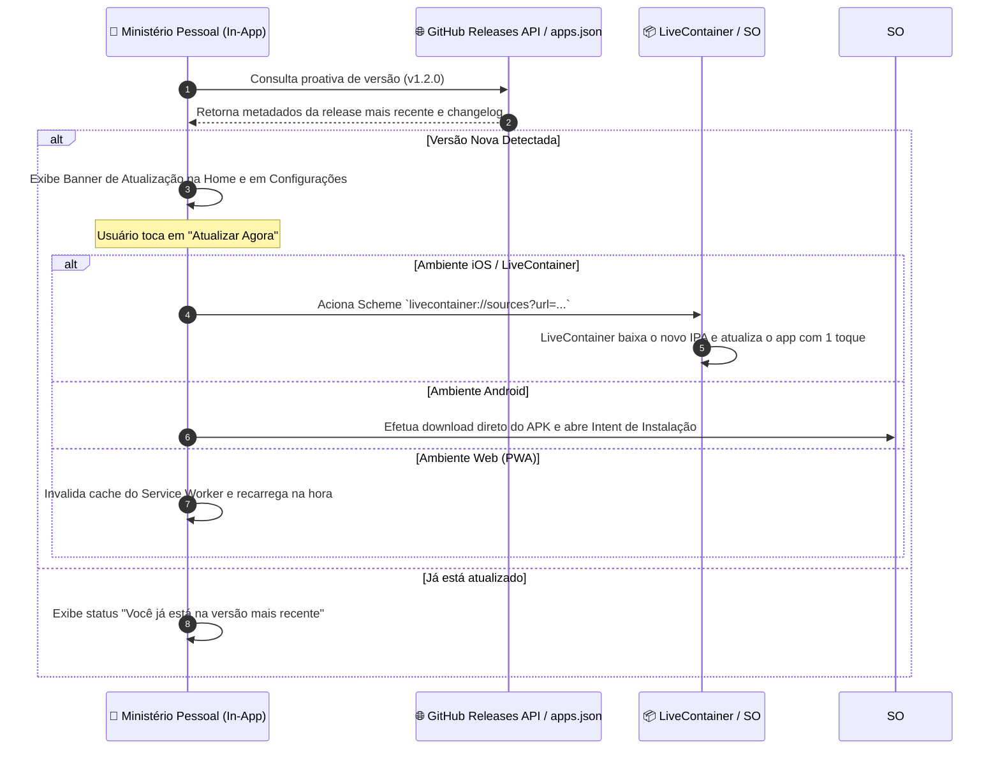
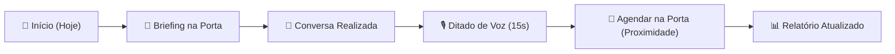

<div align="center">

# 📖 Ministério Pessoal
### *Gestão Eficiente, Discreta e Offline-First do Ministério de Campo*

[-blue?style=for-the-badge&logo=apple&logoColor=white)](https://github.com/eduardoveiga-py/field-assistant/releases/latest)
[](https://flutter.dev)
[](https://dart.dev)
[](https://drift.simonbinder.eu/)
[-brightgreen?style=for-the-badge&logo=checkmarx&logoColor=white)](https://github.com/eduardoveiga-py/field-assistant/actions)
[](https://github.com/eduardoveiga-py/field-assistant/releases)

<p align="center">
  <b>Um aplicativo completo, ágil e focado na rotina ministerial para organizar contatos, revisitas, cursos bíblicos, compromissos, territórios e relatórios mensais.</b><br>
  <i>Funciona 100% offline, sem anúncios, com privacidade absoluta e sincronização multi-dispositivo opcional.</i>
</p>

[📥 Baixar Aplicativo](#-downloads-e-instalação) • [🔄 Atualizações & LiveContainer](#-atualizador-automático--livecontainer-arquitetura) • [✨ Recursos Principais](#-recursos-pensados-para-o-ministério) • [🚀 Guia Rápido de Uso](#-guia-rápido-de-uso) • [🔒 Privacidade e Segurança](#-privacidade-e-segurança-inviolável) • [📋 Detalhes dos Lançamentos](#-histórico-de-lançamentos-e-changelog)

---

</div>

## 📥 Downloads e Instalação

Acesse a página de **[Releases Oficiais](https://github.com/eduardoveiga-py/field-assistant/releases/latest)** e baixe o pacote adequado para o seu dispositivo:

| Plataforma | Pacote | Como Instalar |
| :--- | :--- | :--- |
| **Android** | [`app-arm64-v8a-release.apk`](https://github.com/eduardoveiga-py/field-assistant/releases/latest/download/app-arm64-v8a-release.apk) | Baixe diretamente no aparelho Android, abra o arquivo e confirme a instalação (autorizando fontes desconhecidas se solicitado). |
| **iPhone / iPad** | [`app-release-unsigned.ipa`](https://github.com/eduardoveiga-py/field-assistant/releases/latest/download/app-release-unsigned.ipa) | Instale via **LiveContainer**, **AltStore**, **SideStore**, **TrollStore** ou **Sideloadly** com suporte a atualizações contínuas via catálogo interno ou link direto. |
| **Navegador (Web)** | `web-release.zip` / Acesso Online | Acesse diretamente pelo Chrome, Safari ou Edge e toque em **"Adicionar à Tela de Início"** para instalar como PWA nativo com SQLite Wasm local. |
| **Windows 10/11 (x64)** | [`field-assistant-windows-x64.zip`](https://github.com/eduardoveiga-py/field-assistant/releases/latest/download/field-assistant-windows-x64.zip) | Extraia o `.zip` para uma pasta local e execute `ministerio_pessoal.exe`. |
| **Linux (GTK x64)** | [`field-assistant-linux-x64.tar.gz`](https://github.com/eduardoveiga-py/field-assistant/releases/latest/download/field-assistant-linux-x64.tar.gz) | Extraia o arquivo (`tar -xzf field-assistant-linux-x64.tar.gz`) e execute `./ministerio_pessoal`. |
| **macOS** | [`field-assistant-macos.zip`](https://github.com/eduardoveiga-py/field-assistant/releases/latest/download/field-assistant-macos.zip) | Descompacte o `.zip`, mova o `.app` para a pasta **Aplicativos** e abra o aplicativo. |

### 📱 Fonte Oficial para LiveContainer & AltStore (iOS)

Adicione o Ministério Pessoal diretamente como **Fonte (Source)** no **LiveContainer** ou **SideStore/AltStore** para receber e atualizar o app internamente:

* **URL da Fonte:** `https://cdn.jsdelivr.net/gh/eduardoveiga-py/field-assistant@master/apps.json`
* **Adicionar ao LiveContainer com 1 Toque:** [Toque aqui para abrir no LiveContainer](livecontainer://sources?url=https://cdn.jsdelivr.net/gh/eduardoveiga-py/field-assistant@master/apps.json)

> [!TIP]
> **Modo Offline Sem Conta**: Você não precisa criar conta nem efetuar login para usar o app! Ao abrir pela primeira vez, toque em **"Continuar em Modo Offline (Sem Conta)"** e o sistema funcionará imediatamente com banco de dados SQLite local no seu aparelho.

---

## 🔄 Atualizador Automático & LiveContainer: Arquitetura

### ❓ É possível criarmos um atualizador automático para nosso app? Ele verifica se tem atualização e atualiza a partir do próprio app, ou sou obrigado a atualizar via LiveContainer?

Esta é uma das perguntas arquiteturais mais importantes no ecossistema iOS e sideloading. A resposta técnica precisa divide-se em duas partes:

#### 1. A Restrição de Sandbox do iOS (Por que nenhum app iOS pode se auto-substituir diretamente)
No iOS (inclusive em aparelhos com sideloading sem jailbreak como LiveContainer, SideStore e AltStore):
- A Apple impõe proteção estrita de memória **W^X** (Write XOR Execute) e validação de assinatura pelo kernel (`amfid` / `seatbelt`).
- O sandbox do sistema operacional **proíbe terminantemente** que um processo em execução sobrescreva seu próprio binário executável (`Mach-O`) em tempo de execução.
- Se um aplicativo tentasse substituir seu próprio executável em disco enquanto está em execução, ocorreria corrupção de memória e encerramento forçado imediato pelo kernel (`SIGKILL`).

#### 2. Como o Ministério Pessoal resolve isso elegantemente (In-App Auto-Update Workflow)
Em vez de forçar o usuário a procurar manualmente no GitHub a cada nova versão, implementamos um **fluxo integrado em dois níveis**:



1. **Checagem Automática Integrada**:
   - O `UpdateCheckerService` verifica a versão na Splash Screen, na tela de Início (Home) e na aba Configurações através da API do GitHub Releases (`/releases/latest`) com fallback para o CDN do `apps.json`.
   - Compara versões usando Semver canônico (`Major.Minor.Patch`).
2. **Aviso Visual com Changelog**:
   - Quando há nova versão, um card visual destacado informa o número da versão, data de lançamento, tamanho do download em MB e notas do lançamento.
3. **Ação de Atualização em 1 Toque**:
   - **No iOS (LiveContainer)**: Tocar em **"Atualizar Agora"** dispara a URL `livecontainer://sources?url=...`, comandando o LiveContainer a baixar a nova compilação e atualizar o app sem esforço manual.
   - **No Android**: O aplicativo baixa o pacote `app-arm64-v8a-release.apk` diretamente e invoca o instalador do sistema operacional.
   - **Na Web**: O Service Worker é atualizado e a página é recarregada instantaneamente.

**Conclusão**: O app verifica tudo internamente e avisa você; para aplicar o novo binário no iOS, ele se comunica com o LiveContainer com 1 único toque, garantindo total conformidade com o sistema sem risco de quebra de assinatura.

---

## ✨ Recursos Pensados para o Ministério

### 🚪 1. Briefing na Porta (30 Segundos)
Antes de bater à porta, consulte rapidamente um resumo estratégico do morador:
- **Onde paramos**: última lição e ponto considerado no livro *Seja Feliz para Sempre!*.
- **Próximo passo acordado**: pergunta pendente ou assunto acordado para a revisita.
- **Toque de empatia**: detalhes pessoais (família, saúde, preferências) para uma conversa calorosa.
- **Data da última visita**: acompanhe com exatidão o tempo decorrido desde o último contato.
- **Link Direto**: abra o parágrafo exato diretamente no **JW Library** ou jw.org com um toque.

---

### 🎙️ 2. Anotação Rápida por Ditado de Voz (15s)
Enquanto caminha entre uma residência e outra, registre tudo sem precisar digitar no teclado:
- Grave e dite uma nota de voz de 15 segundos.
- O motor inteligente extrai o **número da lição**, o **ponto considerado**, o nome do estudante e os detalhes de empatia.
- Os campos do formulário são pré-preenchidos automaticamente para você salvar em menos de 3 toques.

---

### 🗓️ 3. Agenda Inteligente & Feriados Nacionais
- **Anti-Colisão de Horários**: detecta sobreposições de compromissos e sugere horários vagos no mesmo dia.
- **Feriados Brasileiros**: feriados nacionais (fixos e móveis calculados por Páscoa/Carnaval) aparecem destacados no calendário mensal para facilitar o planejamento de saídas de campo.
- **Sincronização Bidirecional**: conecte com Google Calendar e Apple Calendar mantendo eventos sincronizados.

---

### 📍 4. Agendamento de Retorno na Porta por Proximidade
- No perfil do contato, acione o botão **"Agendar Retorno na Porta (Proximidade)"**.
- O motor geodésico analisa:
  - O horário habitual de preferência da pessoa (ex: "Sábado 10:00").
  - A vizinhança geográfica com outros estudos e revisitas agendados para a mesma saída.
  - Buffers de deslocamento a pé (15 min) e veicular.
  - Conflitos com compromissos locais e calendários externos.
- Sugere os melhores horários para confirmar o compromisso com 1 toque.

---

### 🗺️ 5. Territórios Inteligentes & Análise de Cobertura
- **Índice de Cobertura ($IC$)**: cálculo determinístico da porcentagem do território percorrida nos últimos 90 dias:
  $$\text{IC} = \frac{\text{Endereços Trabalhados nos Últimos 90 Dias}}{\text{Total de Endereços Ativos}} \times 100$$
- **Zonas Esquecidas (>90 dias)**: identificação instantânea de residências ou ruas sem visita recente, exibidas com destaque visual no mapa para reativação ordenada do território.
- **Camadas Visuais por Cor**:
  - 🟢 Visitado recentemente (<30 dias)
  - 🟡 No ciclo de revisita (30 a 90 dias)
  - 🟣 Cursos Bíblicos ativos
  - 🔴 Zonas Esquecidas (>90 dias)
- **Mapas Offline**: faça o download dos blocos em níveis de zoom 13 a 17 para navegar em bairros e áreas rurais sem sinal de celular.

---

### 📥 6. Interoperabilidade de Territórios (KML, GeoJSON e CSV)
- **Exportação e Importação Flexível**:
  - **KML 2.2**: compatível com Google Earth, Organic Maps e GPS automotivo.
  - **GeoJSON (RFC 7946)**: formato padrão para SIG (Sistemas de Informação Geográfica) e mapas web.
  - **CSV Universal**: planilha editável no Excel, Google Planilhas ou LibreOffice.
- Exporte pontos com nome, telefone, endereço, notas e coordenadas com um toque na barra de ferramentas do mapa.

---

### 🔍 7. Detecção Inteligente de Endereços Duplicados
- Motor geodésico baseado na fórmula de **Haversine** e similaridade textual (bigramas de Sorensen-Dice).
- Detecta registros cadastrados em duplicidade no território quando:
  - A distância física for inferior a **25 metros** E o nome tiver similaridade $\ge 0.60$ (ou mesmo endereço).
  - O endereço for idêntico e o raio for de até **50 metros**.
- Evita que dois publicadores visitem o mesmo morador por engano.

---

### 🏹 8. Assistente Linguístico & Tradução
- Aba expandida para apoiar publicadores em regiões multilíngues, de fronteira e campos indígenas:
  - **Língua de Referência (Golden Flagship)**: **Ticuna** (*Magüta* / *Tikuna*), falado por dezenas de milhares de irmãos no Alto Solimões e fronteira Brasil-Colômbia-Peru.
  - **Línguas Suportadas**: Português, Ticuna, Espanhol, Guajajara (*Tenetehara*) e Yanomami (*Yanomamõ*).
- **6 Momentos-Chave do Ministério**:
  1. *Saudação Inicial* (cumprimento cordial cultural)
  2. *Leitura Bíblica* (apresentação de textos confortadores)
  3. *Pergunta para Revisita* (questão reflexiva para o retorno)
  4. *Oferta de Estudo* (convite para o curso bíblico)
  5. *Lidando com Objeções* (respostas calmas e respeitosas)
  6. *Despedida Cordial* (fechamento afetuoso)
- **Comparador Multilíngue**: compare expressões lado a lado em Português, Ticuna e Espanhol com guia fonético e áudio de pronúncia nativa.
- **Fichas de Memorização (Algoritmo SM-2)**: modo flashcard com repetição espaçada SuperMemo-2 para memorizar saudações e frases teocráticas.
- **Histórico de Buscas**: acesso rápido aos termos mais pesquisados no campo.

---

### 🌐 9. Internacionalização Nativa (i18n)
- Suporte a múltiplos idiomas na interface do usuário:
  - 🇧🇷 **Português (Brasil)** - Padrão / Golden Master
  - 🇺🇸 **English (US)**
  - 🇪🇸 **Español**
- Catálogo tipado e seguro (`AppLocaleStrings`) com fallback automático para Português em caso de termos não traduzidos.
- Seletor de idioma em tempo real na aba **Configurações**.

---

### 🎨 10. Identidade Visual Conectada & Saudações Dinâmicas
- **Hero Chromatic Accent Band**: barra cromática elegante no topo das telas secundárias, harmonizada com as cores dos cards da tela de Início:
  - 🟣 Estudos Bíblicos (Roxo Teocrático)
  - 🔵 Pessoas e Contatos (Azul Ministerial)
  - 🟡 Agenda de Retornos (Âmbar Solar)
  - 🟢 Idiomas & Tradução (Verde Esmeralda / Floresta)
  - 🔷 Mapas & Territórios (Índigo Profundo)
- **Saudação Dinâmica Contextual**: mensagem calorosa adaptada ao momento do dia (manhã, tarde, noite) com container translúcido glassmorphic na tela inicial.

---

### ☀️ 11. Modo Sol Intenso (Alto Contraste WCAG AAA)
- Sob a luz forte do sol no campo, ative o **Modo Sol** no topo da tela com 1 toque.
- Ajusta instantaneamente contraste de fontes, ícones e bordas escuras sem sombras suaves, eliminando reflexos incômodos sob o sol do meio-dia.

---

### 📊 12. Relatórios & Contagem Rigorosa
- Regras de contagem transparentes e alinhadas às diretrizes oficiais:
  - Casais ou famílias estudando juntos contam exatamente como **1 estudo bíblico**.
  - Apenas sessões de estudo efetivamente realizadas somam no mês.
  - Tentativas sem contato não são computadas como conversas.
- Acompanhamento do **Ritmo de Pioneiro** para planejar e atingir metas de horas com serenidade.

---

### 🔐 13. Sincronização Multi-Dispositivo & Offline-First
- Funciona 100% offline em qualquer lugar remoto.
- Ao conectar sua conta no Supabase, o app sincroniza automaticamente todas as tabelas na Splash Screen com fila persistente e resolução de conflitos idempotente.

---

### 📋 14. Tarefas & Projetos com Pesquisa, Tags, Filtros e Descrição Visível
- **Pesquisa e Filtros Ágeis**: barra de pesquisa dedicada combinada com filtros rápidos por prioridade, categoria e tags.
- **Descrição Visível no Card**: a descrição detalhada das tarefas agora é exibida diretamente no card da tarefa (resolvendo o problema de visualização truncada), acompanhada de badges de prazos e tags.
- **Editor Rico com Markdown & Imagens**: criação e edição de tarefas e projetos agora contam com o `RichMarkdownToolbar` completo, permitindo formatação avançada, listas e inclusão de imagens.
- **Anexos Universais**: tarefas suportam anexos com abertura direta no Visualizador Universal.

---

### 📧 15. Inbox, E-mail Teocrático (JW Pub) & Trava Biométrica Global
- **Trava Biométrica em Toda a Aba Inbox**: proteção integral de segurança (Face ID / Touch ID / PIN) exigida logo ao abrir a tela de Inbox, protegendo capturas, notas, e-mails e cartas.
- **Configuração IMAP JW.org nas Configurações**: formulário completo para sincronização com o e-mail teocrático (`mail.jw.org`, porta `993`, com credenciais salvas de forma segura no banco local e botão "Testar Conexão e Salvar").
- **Edição Completa de Capturas**: qualquer item capturado no Inbox pode ser editado (conteúdo, categoria, metadados) via modal dedicado.
- **Retenção Permanente Imune à Purga**: mensagens e correspondências permanecem salvas localmente no Drift SQLite, imunes à purga remota de 90 dias do servidor.
- **Visualização Universal de Anexos**: qualquer anexo de e-mail ou nota abre diretamente no leitor nativo integrado.

---

### 📚 16. Base de Conhecimento: Tags, Clamping, Leitor Imersivo & Correção de PDFs
- **Tags e Filtros**: suporte completo a tags com chips interativos para filtrar Notas, Dúvidas, Documentos e Recursos.
- **Cards com Altura Máxima Clamped**: visual organizado e compacto que nunca transborda verticalmente.
- **Leitor Dedicado em Modal (`showKnowledgeItemReader`)**: ao clicar em qualquer card, abre-se uma tela imersiva de leitura com Markdown estilizado, imagens inline, badges de links e tags.
- **Correção Definitiva de Leitura de PDFs**: visualizador com fallback inteligente integrado via `PdfPreview` (pacote `printing`), permitindo visualizar qualquer PDF local sem depender de aplicativos externos falharem.
- **Editor Rico em Dúvidas e Recursos**: `RichMarkdownToolbar` incorporado em todas as seções para formatação de texto, imagens e links teocráticos.

---

### 📖 17. Estudos Bíblicos: Pesquisa, Filtros, Tags e Cards Recolhíveis/Expandíveis
- **Cards Recolhíveis e Expansíveis (1 Toque)**: economize espaço vertical de forma dramática no celular ou tablet. Em modo compacto, os cards mostram avatar, estudante, publicação, lição/parágrafo e badges essenciais. Ao tocar, expandem suavemente para exibir participantes, histórico de lições e botões de ação.
- **Expandir / Recolher Todos**: botão no topo da lista para alternar todos os estudos simultaneamente.
- **Pesquisa em Tempo Real**: localize rapidamente qualquer estudo por nome do estudante, título, publicação ou tags.
- **Filtros por Publicação e Tags**: filtre por publicação específica (*Seja Feliz para Sempre!* livro ou brochura) e por marcadores/metas teocráticas (#Batismo, #Família, etc.).
- **Gestão de Tags de Estudo**: campos dedicados para definir marcadores tanto na criação quanto na edição do estudo bíblico.

---

### 🖼️ 18. Visualizador Universal de Anexos
- **Suporte Multiformato Nativo em Todo o App**:
  - 📄 **PDFs**: renderizados de forma nítida com navegação de páginas e zoom via `PdfPreview`.
  - 🖼️ **Imagens (JPG, PNG, WebP)**: visualização em tela cheia com zoom interativo por pinça (`InteractiveViewer`) e rotação.
  - 🎵 **Áudio (M4A, MP3, WAV, AAC)**: reprodutor de áudio integrado com barra de progresso, botão play/pause e tempo decorrido.
  - 📝 **Documentos de Texto e Markdown**: visualizador monospaçado estilizado com botão de cópia.
  - 🔗 **Fallback do Sistema**: opção "Abrir em App Externo" integrada para formatos complementares.

---

### ✍️ 19. Editor Rico com Imagens Inline & Links Teocráticos (JW.org)
- **Barra de Formatação `RichMarkdownToolbar`**:
  - 🖼️ **Inserir Imagem**: escolha da galeria, câmera ou URL, inserindo sintaxe de markdown ``.
  - 📖 **Inserir Link de Publicação / Vídeo**: insere links formatados para jw.org e JW Library (`[📖 Título](url)` ou `[🎥 Título](url)`).
  - Suporte completo em Experiências no Ministério, Notas, Tarefas, Projetos, Dúvidas e Recursos.

---

### 🔒 20. Google Calendar: Persistência de Sessão e Eliminação de Popups Recorrentes
- **Sessão Persistente**: a conta Google selecionada fica armazenada em cache persistente local (`AppKvStore`), evitando que a janela de seleção de conta do Google seja exibida repetidamente ao navegar no aplicativo.
- **Gerenciamento em Configurações**: a aba Configurações permite visualizar a conta atualmente conectada, alternar de conta com 1 toque ("Trocar") ou desconectar ("Desconectar").
- **Chamadas Silenciosas**: sincronizações em segundo plano utilizam verificação não intrusiva (`promptIfNecessary: false`), garantindo paz ao usuário durante o uso do aplicativo.

---

### 🎓 21. Fotos e Avatares de Estudantes Bíblicos
- **Consistência Visual**: na aba **Estudos Bíblicos**, cada card de estudante exibe a foto do estudante ou seu avatar circular com iniciais, exatamente idêntico à aba **Pessoas**.
- **Resiliência na Busca**: suporte a vínculo por participante ou correspondência direta do nome do estudante/morador com fotos cadastradas.
- Presente tanto na visualização priorizada (Visão Geral de Progresso) quanto na lista completa de estudos ativos e concluídos.

---

## 🚀 Guia Rápido de Uso



1. **Adicionar Contato**:
   Na aba **Pessoas**, toque em `+` e informe o nome, endereço e preferências do morador.
2. **Iniciar um Estudo Bíblico**:
   No perfil da pessoa, vincule o curso bíblico com a publicação *Seja Feliz para Sempre!*. O app acompanhará o progresso de cada lição.
3. **Registrar Visita**:
   Após falar com a pessoa, abra a tela dela ou use o ditado de voz. Confirme o que foi considerado e defina a data de retorno.
4. **Agendar Retorno na Porta**:
   Toque em *Agendar Retorno na Porta (Proximidade)* para receber sugestões de horários sem colisão e otimizar a rota de retorno.
5. **Fechar o Mês**:
   Na aba **Atividades**, veja o total de horas, publicações entregues, vídeos mostrados, revisitas e estudos bíblicos prontos para envio.

---

## 🔒 Privacidade e Segurança Inviolável

- 🛡️ **Zero Telemetria / Sem Anúncios**: Seus contatos ministeriais e anotações pertencem apenas a você.
- 🔐 **Backups Criptografados de Ponta a Ponta**:
  - Criptografia militar **AES-256 GCM** com derivação de chave **PBKDF2** (100.000 iterações).
  - Exporte seu arquivo de backup com senha pessoal e restaure em qualquer aparelho.
- 📴 **100% Offline-First**: O banco de dados SQLite reside fisicamente na memória do seu próprio telefone.

---

## 📋 Histórico de Lançamentos e Changelog

### 🚀 Versão 1.3.3 (Build 10) — 11/11/2026: Operação Integral Sem Stubs, Endurecimento Supabase e Secrets Embutidos no CI
- **Configuração Supabase & OAuth Embutida nos Binários**:
  - `SUPABASE_URL`, `SUPABASE_ANON_KEY`, `GOOGLE_WEB_CLIENT_ID` e `GOOGLE_IOS_CLIENT_ID` injetados automaticamente nos 6 alvos de build do GitHub Actions (`Web`, `Android APK`, `iOS IPA`, `Windows`, `Linux` e `macOS`) via `--dart-define`, sem credenciais hardcoded no código-fonte.
- **Alinhamento Completo do Banco Supabase e Segurança**:
  - Schema remoto e migrações locais alinhados para todas as 26 tabelas sincronizadas + `sync_queue`, criação e políticas RLS do bucket privado `ticuna_audio`, proteção otimista em `sync_upsert`, índices de chave estrangeira e RLS otimizado com `(select auth.uid())`.
- **Funcionalidades Reais e Segurança Local**:
  - E-mail IMAP/SMTP operacional (`JwEmailService`), armazenamento offline de mapas `.mbtiles` (`MbtilesService`), geolocalização real (`geolocator`) sem coordenadas ou seeds fictícios, PIN obrigatório na ausência de biometria, verificação SHA-256 fail-closed para atualizações Android, sincronização completa das 7 tabelas estratégicas com tela de resolução de conflitos e backup/restauração cifrados integrais.

### 🚀 Versão 1.3.2 (Build 9) — 10/11/2026: Suporte Nativo Completo para Desktop (Windows, Linux e macOS)
- **Compilação Nativa Desktop e Distribuição Universal**:
  - Geração automatizada no GitHub Actions de binários nativos para **Windows 10/11 x64** (`field-assistant-windows-x64.zip`), **Linux GTK x64** (`field-assistant-linux-x64.tar.gz`) e **macOS Universal** (`field-assistant-macos.zip`), somados aos binários oficiais de **Android**, **iOS/iPadOS** e **Web**, acompanhados de manifesto de integridade `SHA256SUMS.txt`.
- **Abstrações e Isolamento Seguro de Plugins Móveis**:
  - **`VoiceDictationService`**: Factory condicional com fallback gracioso para plataformas desktop sem reconhecimento de voz nativo contínuo, preservando gravação de áudio e entrada manual no `QuickVoiceNoteDialog`.
  - **`CalendarProvider` / `AppleEventKitProvider`**: Isolamento condicional de plataforma impedindo chamadas nativas ao `device_calendar` em Windows, Linux e macOS, desabilitando o calendário Apple graciosamente na UI enquanto mantém o Google Calendar ativo.
- **Scaffolding e Compatibilidade CMake / MSVC / GStreamer**:
  - Estruturas nativas configuradas para `linux/` (GTK+ 3.0) e `macos/` (entitlements Sandbox de rede, áudio/microfone e arquivos + `Info.plist`).
  - Correções no build desktop para compatibilidade com **MSVC 14.51 (Visual Studio 2026)**, `local_auth_windows` e isolamento do `jni` transitivo.

### 🚀 Versão 1.3.1 (Build 8) — 09/11/2026: Paridade Cartográfica Organic Maps, Extensibilidade Multilíngue e Hardening de Módulos
- **Paridade Cartográfica Avançada com Organic Maps (Anti-Flicker, Camadas, Bússola e 23 Regiões)**:
  - **Eliminação Total de Flashes no Zoom**: Implementação de pirâmide de blocos com cache de fallback multinível (`getFallbackFromMemory`): ao alterar o zoom, o mapa preserva e escala o bloco pai ($z-1$ / $z-2$) em memória até o carregamento assíncrono do bloco exato, eliminando 100% da tela cinza piscando.
  - **4 Camadas e Estilos de Mapas Selecionáveis**: Botão flutuante de camadas (`Icons.layers_rounded`) permitindo alternar instantaneamente entre:
    - 🗺️ *Padrão (OpenStreetMap)*: Ruas, números e povoados com máxima legibilidade.
    - 🛰️ *Satélite (Esri World Imagery)*: Fotografia aérea de alta resolução para identificar telhados, trilhas e rios na Amazônia.
    - 🏔️ *Topográfico (OpenTopoMap)*: Curvas de nível, relevo e hidrografia para zonas rurais e ribeirinhas.
    - 🌙 *Modo Noturno (Carto Dark)*: Alto contraste para economia de bateria e ministério noturno.
  - **Catálogo de 23 Regiões do Brasil no Gerenciador de Downloads**: Estrutura idêntica ao Organic Maps (`Brasil — Mapas: 1 de 23`), cobrindo todos os estados e eixos estratégicos (Santo Antônio do Içá, Yanomami, Guajajara, Manaus, São Paulo, Rio, Curitiba, Brasília, etc.), com resumo de megabytes instalados e barra de rodapé persistente com botão "Atualizar tudo".
  - **Toque Longo para Marcações**: Gesto de pressão longa em qualquer ponto do mapa captura as coordenadas $(lat, lng)$ e abre o formulário de cadastro de marcadores com endereço e coordenadas já preenchidos.
  - **Bússola Magnética & Rotação Contínua**: Agulha apontando para o Norte magnético ($360^\circ$); toque rápido redefine para $0^\circ$ e toque longo gira $90^\circ$ em sentido horário.
  - **Modo Tela Cheia 100% Imersivo**: Oculta o `NavigationRail` no iPad/Desktop e o `NavigationBar` no Mobile, dedicando a tela inteira exclusivamente ao mapa com botão flutuante de saída.
  - **Escala Métrica Dinâmica**: Barra métrica estilo colchete (`|────────|`) com cálculo geodésico em tempo real de metros por pixel em função da latitude e zoom.

- **Extensibilidade Multilíngue Persistente & Criação de Idiomas**:
  - Persistência reativa do idioma ativo no SQLite via `AppKvStore` (`active_language_code`), mantendo a escolha do usuário entre sessões e reinicializações.
  - Seeding formal de 5 idiomas teocráticos padrão no banco Drift (`tca` Ticuna [Padrão], `por` Português, `spa` Espanhol, `gub` Guajajara e `yan` Yanomami) executado no `beforeOpen` de migração.
  - Barra dinâmica de caracteres especiais (diacríticos) ajustada automaticamente conforme o idioma selecionado.
  - Sistema extensível para cadastrar e gerenciar novos idiomas indígenas e estrangeiros dentro do aplicativo com símbolos, diacríticos customizados e vocabulário individualizado.

- **Visualizador Universal Multi-Formato (`UniversalAttachmentViewerDialog`)**:
  - Visualizador integrado para todos os formatos de anexos: PDFs via `PdfPreview` (com zoom contínuo, impressão e compartilhamento), imagens interativas com zoom gestual, áudios com player dedicado e textos/markdown. Resolve em definitivo o erro de abertura externa de documentos (ex.: `CIN - Eduardo Veiga.pdf`).

- **Persistência de Autenticação Google & Supressão de Popups**:
  - Verificação de autorização explícita (`_keyUserExplicitlyConnected`) antes de checagens silenciosas do Google Calendar, extinguindo o popup recorrente em localhost e web.
  - Gerenciamento de conta Google centralizado em Configurações com opções para alternar e desconectar conta.

- **Bloqueio Biométrico na Inbox & E-mail JW.org**:
  - Proteção biométrica/PIN na tela inteira da Inbox Universal (`BiometricAuthService`).
  - Formulário completo para conexão de e-mail JW.org (`mail.jw.org`, porta 993) em Configurações com teste de conectividade, remoção e retenção local permanente.

- **Tarefas e Estudos Aprimorados**:
  - Exibição de descrição detalhada diretamente nos cards de tarefas com busca e filtros por tags.
  - Cards de estudos bíblicos retráteis/expansíveis com 1 toque para economia de espaço vertical, com foto/avatar colorido idêntico à aba Pessoas.
  - Barra de edição avançada `RichMarkdownToolbar` em todo o aplicativo com inserção de fotos e links teocráticos formatados (`[📖 ...]`, `[🎥 ...]`).

### 🚀 Versão 1.3.0 (Build 7) — 09/11/2026: A Grande Evolução Estratégica Integrada
- **MÓDULO A — Inbox Universal**:
  - Ponto central e de atrito zero para capturar qualquer informação sem interromper o foco ministerial ou pessoal.
  - Modal adaptativo de captura rápida (`QuickCaptureSheet`) acessível via FAB flutuante e atalho na AppBar da tela Início.
  - 3 modos de captura:
    - ✍️ *Ideia / Texto*: Campo rápido com salvamento instantâneo e chips de categoria (Ministério, Pessoal, Estudo, Dúvida, Ideia).
    - 🎤 *Voz / Ditado*: Gravação de áudio de até 5 minutos (300 segundos) com contador em tempo real, visualizador de onda e player de pré-visualização.
    - 📎 *Documento / Foto*: Anexação de arquivos locais (PDF, DOC, TXT, EPUB) ou fotos da galeria com cálculo automático de tamanho e hash.
  - Tela `InboxScreen` com filtros por status (*Pendentes*, *Em Análise*, *Processadas*, *Todas*), badges por tipo de mídia, player de áudio embutido e menu de triagem.
  - Pipeline de conversão não-destrutiva: transforma itens capturados em **Tarefas**, **Projetos**, **Notas** ou **Dúvidas Teocráticas**, preservando o registro original com `status = 'converted'`, `converted_entity_type` e `converted_entity_id`.

- **MÓDULO B — Tarefas e Projetos**:
  - `TaskManager`: Gerenciador de responsabilidades com suporte a prioridades (*baixa, normal, alta, urgente*), prazos, vínculos a contatos ou estudos e **recorrência automática contínua** (*diária, semanal, mensal*): ao concluir uma tarefa recorrente, a próxima ocorrência é gerada automaticamente com data futura.
  - `ProjectManager`: Estruturação de iniciativas de médio e longo prazo com metas, alvos e cálculo reativo de progresso percentual (`ProjectProgress`: tarefas concluídas / total de tarefas).
  - Tela `TasksScreen` com 5 abas otimizadas:
    - ⚡ *Hoje & Urgentes*: Tarefas com vencimento para hoje ou em atraso.
    - 📋 *Minhas Tarefas*: Lista completa com ordenação inteligente.
    - 📁 *Projetos*: Visão geral dos projetos ativos com barras de progresso % em tempo real.
    - 👥 *Ações de Contatos*: Histórico e pendências de revisitas dos contatos.
    - ✅ *Concluídas*: Registro de tarefas finalizadas.
  - Tela `ProjectDetailScreen` com objetivos, descrição, barra de progresso visual, lista de tarefas vinculadas e modal de adição rápida.

- **MÓDULO C — Base de Conhecimento**:
  - `KnowledgeManager`: Repositório central de conhecimento, estudos e pesquisa teocrática.
  - 4 pilares estruturados na tela `KnowledgeBaseScreen`:
    - 📝 *Notas de Conhecimento*: Anotações ricas em Markdown, marcação de favoritos, fixação de notas importantes no topo e categorização.
    - ❓ *Perguntas & Dúvidas Teocráticas*: Registro de objeções ou dúvidas de moradores para pesquisa posterior, com status *Em Aberto* ou *Respondida*, textos bíblicos de apoio e respostas detalhadas.
    - 📁 *Documentos*: Gerenciador de arquivos locais (apostilas, PDFs, manuais) com tamanho em KB e hash criptográfico SHA-256 para auditoria de integridade.
    - 🔗 *Recursos & JW.org*: Catálogo de links diretos de artigos, vídeos do Ministério e ferramentas do site oficial com abertura rápida externa.

- **Integração Global dos Três Módulos**:
  - `GlobalSearchDelegate`: Barra de busca unificada de `Hoje no Ministério` agora indexa e pesquisa em tempo real Pessoas, Telefones, Agenda, Estudos, **Tarefas**, **Projetos**, **Notas de Conhecimento** e **Itens da Inbox**.
  - `PersonDetailScreen`: Aba *Alvos & Tarefas* sincronizada diretamente com a tabela `tasks` (`watchTasksForPerson`), permitindo gerenciar tarefas formais da pessoa sem perder o histórico legado.
  - `StudiesScreen`: Atalho na AppBar para consulta imediata de recursos e notas de conhecimento durante o curso bíblico.
  - Banco de Dados Drift (Schema v6): 7 novas tabelas (`inbox_entries`, `projects`, `tasks`, `knowledge_notes`, `knowledge_questions`, `knowledge_documents`, `knowledge_resources`), coluna `appointments.task_id` e colunas contextuais em `research_articles`.
  - Migração Supabase DDL com RLS (`auth.uid() = owner_id`), 26 tabelas no `SupabaseSyncService` e 29 tabelas no `BackupService` criptografado (PBKDF2-HMAC-SHA256).

### 🚀 Versão 1.2.1 (Build 6) — 09/11/2026
- **Componentes Adaptativos (Regra 10)**:
  - Implementação do componente universal `showAdaptiveMinistrySheet`: em telas > 600pt (iPads, tablets e navegadores desktop), renderiza como `Dialog` flutuante centralizado (`maxWidth: 720`, `maxHeight: 0.85 * viewportHeight`), cantos 100% arredondados (`BorderRadius.circular(24)`), sombra e botão "✕" de fechar no topo, eliminando a janela vertical infinita. Em telas mobile (<= 600pt), utiliza folha inferior com limite estrito de 88% da altura.
  - Ativação plena de internacionalização em `main.dart` observando `appLocaleTypeProvider` e plugging dinâmico de `appStringsProvider` no `MainNavigationShell`.
- **Assistente de Idiomas Dinâmico no Drift (Regra 11 - Schema v5)**:
  - Nova tabela `AppLanguages` integrada com persistência local SQLite, mantendo 100% dos dados legados e seeding do Ticuna (`tca`) como língua padrão.
  - Seletor Pill interativo no AppBar da aba de Idiomas (`🏹 Ticuna (Magüta) ▾`).
  - Modal `+ Novo Idioma` com atalhos de 1-toque para línguas pré-catalogadas (`🌿 Guajajara` e `🌳 Yanomami`) a partir do `LanguageRegistry`.
  - Barra de diacríticos dinâmica (`TicunaDiacriticsBar`) que exibe em tempo real os caracteres especiais do idioma ativo e auto-oculta para idiomas sem diacríticos.
  - Filtragem dinâmica de vocabulário, frases de campo e flashcards SM-2 pelo `language_id` ativo.
- **Motor Cartográfico de Alto Desempenho estilo Organic Maps (Regra 12 & Imagem 2)**:
  - Rotação 2D contínua em qualquer ângulo ($360^\circ$) por gesto de dois dedos na tela.
  - Bússola interativa na tela com agulha apontada para o Norte Magnético e reset instantâneo para 0° ao tocar.
  - Barra de escala métrica dinâmica (50m, 200m, 1 km, 5 km) recalculada em tempo real com base na latitude e zoom.
  - Botão flutuante de Tela Cheia (Fullscreen toggle) para expansão imersiva e ocultação de barras de navegação no iPad.
  - GPS nativo de alta precisão no iPadOS e Android: ponto azul pulsante com raio de precisão e cone de orientação (heading), com permissões em `AndroidManifest.xml` e `Info.plist`.
  - Gerenciador "Baixar Mapas" completo idêntico à Imagem 2: campo de busca `Localizar mapa`, seção `Baixado (X MB)`, catálogo hierárquico por país/estado (ex.: Brasil > Amazonas — Santo Antônio do Içá & Alto Solimões), barra de progresso em MB e botão `Atualizar tudo`. Suporte consolidado a arquivos SQLite `.mbtiles` servidos localmente com tempo de resposta ultrarrápido (<0.2ms) e zero risco de banimento de IP no OSM.
- **Auditoria Crítica de Sincronização e Resiliência (C1 a C5)**:
  - C1: Backoff exponencial real na `sync_queue` com limite de até 5 tentativas (`last_attempt_at`), transicionando para dead-letter queue `'failed'` com opção de reprocessamento manual.
  - C2: Ciclo de sincronização pull-before-push com pré-verificação de revisão remota antes de upsert, merge 3-way e substituição de exclusão cega por soft-delete (`deleted_at`).
  - C3: Substituição do executor fantasma na Web por `_SafeWebUnavailableQueryExecutor`, interrompendo silenciosos descartes de escrita.
  - C4: Utilitário universal `SyncTimestamp.parse(dynamic v)` tolerante a inteiros em milissegundos, segundos, instâncias `DateTime` e ISO-8601.
  - C5: Normalização estrita de payloads para formato ISO-8601 na restauração de backups (`backup_service.dart`), eliminando erro 400 do PostgREST.
- **Hardening de Segurança e Auditoria (A1 a A10, M1 a M13)**:
  - Validação de integridade criptográfica SHA-256 no verificador de atualizações.
  - Limpeza completa de PII em User-Agent e credenciais hardcoded.
  - 100% de testes automatizados passando e 0 issues no `dart analyze`.

### 🚀 Versão 1.2.0 (Build 5) — 08/11/2026
- **Centralização de Versão**:
  - Criação da classe `AppVersion` em `lib/core/app_version.dart` como fonte única da verdade para versão (`1.2.0`), compilação (`5`), release date, User-Agent canônico e esquemas do LiveContainer.
- **Atualizador Automático In-App**:
  - Implementação do `UpdateCheckerService` com consulta ao GitHub Releases API e fallback via CDN do `apps.json`.
  - Banner visual inteligente na Splash Screen, na tela de Início (Home) e em Configurações, exibindo notas da versão e tamanho em MB.
  - Ação em 1 toque conectada ao esquema oficial `livecontainer://sources?url=...` no iOS, download direto de APK no Android e reload de Service Worker na Web.
- **Assistente Teocrático de Idiomas & Tradução**:
  - Expansão do módulo com `LanguageRegistry` suportando Ticuna (golden flagship), Português, Espanhol, Guajajara e Yanomami.
  - 6 Momentos-Chave do ministério com frases situacionais, guias fonéticos e áudios de pronúncia.
  - Comparador multilíngue e modo Flashcards com repetição espaçada SM-2 (SuperMemo-2).
  - Histórico persistente de pesquisas recentes.
- **Internacionalização (i18n)**:
  - Catálogo tipado `AppLocaleStrings` com suporte a Português (Brasil), Inglês (US) e Espanhol com fallback automático.
  - Seletor dinâmico de idiomas em Configurações.
- **Território Inteligente & Análise de Cobertura**:
  - Cálculo do Índice de Cobertura ($IC$) nos últimos 90 dias.
  - Identificação e overlay de Zonas Esquecidas (>90 dias sem visita).
  - Detecção automática de endereços duplicados por proximidade geodésica (<25m Haversine) e similaridade textual de bigramas.
  - Exportação e importação completa em KML 2.2, GeoJSON (RFC 7946) e CSV.
- **Agendamento de Retorno na Porta por Proximidade**:
  - Botão de 1 toque no perfil do contato (`DoorstepReturnBookingDialog`).
  - Motor de cálculo de horários com base em preferências habituais, proximidade física de outros estudos e buffers de deslocamento.
  - Detecção automática de conflitos com agenda local e calendários externos.
- **Identidade Visual Conectada**:
  - Componente `ScreenHeroAccentBand` integrando as cores dos cards da Home com as barras de navegação das telas secundárias.
  - Saudação dinâmica contextual conforme o período do dia (manhã, tarde, noite) com efeito glassmorphic.
- **CI/CD Paralelo Otimizado**:
  - Desacoplamento do workflow do GitHub Actions em jobs paralelos (`test_and_lint`, `build_android_and_web`, `ios_build_check`, `publish_release`) para redução drástica do tempo de CI.
- **Suíte de Testes**:
  - Suíte expandida para mais de 630 testes automatizados com 100% de aprovação e zero issues no `dart analyze`.

### 📦 Versão 1.1.2 — 07/11/2026
- Adicionada verificação de compatibilidade com LiveContainer iOS.
- Correção no tamanho e hashes do pacote IPA no catálogo `apps.json`.
- Melhorias na estabilidade da fila de sincronização offline com Supabase.

### 📦 Versão 1.1.1 — 06/11/2026
- Ajustes de responsividade para telas pequenas de smartphones.
- Aperfeiçoamento do Modo Sol Intenso sob iluminação direta.
- Cache nativo aprimorado para renderização rápida de azulejos OpenStreetMap.

### 📦 Versão 1.1.0 — 05/11/2026
- Lançamento do módulo de Territórios e Setores com suporte a marcos de referência (POIs).
- Integração da publicação *Seja Feliz para Sempre!* com links profundos para o JW Library.
- Ditado rápido de notas de voz com extração inteligente de dados da visita.

### 📦 Versão 1.0.0 — 01/11/2026
- Lançamento inicial oficial do Ministério Pessoal com arquitetura 100% Offline-First.
- Gestão de contatos, estudos bíblicos, agenda ministerial e contagem rigorosa de relatórios.
- Criptografia AES-256 GCM e backups locais protegidos por senha.

---

## 🛠️ Desenvolvimento e Compilação

<details>
<summary><b>Clique para expandir instruções técnicas para desenvolvedores</b></summary>
<br>

### Pré-requisitos
- **Flutter SDK**: 3.27+ (canal estável).
- **Dart SDK**: 3.5+.
- **Java JDK**: 17 (Zulu ou OpenJDK).

### Instalação e Execução
```bash
# 1. Clonar repositório e obter dependências
git clone https://github.com/eduardoveiga-py/field-assistant.git
cd field-assistant
flutter pub get

# 2. Gerar código do banco Drift e Riverpod
dart run build_runner build --delete-conflicting-outputs

# 3. Executar em desenvolvimento
flutter run -d chrome      # Navegador Web
flutter run -d windows     # Desktop Windows
flutter run -d <device-id> # Dispositivo Android / iOS
```

### Qualidade de Código e Testes
```bash
# Análise estática obrigatória (zero warnings/erros)
dart analyze lib test --fatal-infos

# Suíte completa de testes automatizados com cobertura
flutter test --coverage
```

### Compilação de Produção
```bash
# Web SPA com SQLite Wasm
flutter build web --release

# Android APK
flutter build apk --release

# iOS (binário de release sem assinatura para LiveContainer/AltStore)
flutter build ios --no-codesign --release
```

### Estrutura de Pastas
```
lib/
  ├── core/            # AppVersion, AppTheme, i18n, logging e utilitários
  ├── database/        # Drift ORM (SQLite / Wasm) e repositório de dados
  ├── appointments/    # Motor de agenda, colisões, feriados e agendamento por proximidade
  ├── contacts/        # Briefing na porta e gerenciamento de pessoas
  ├── studies/         # Gestão de cursos bíblicos, lições e sessões
  ├── voice_notes/     # Gravador de áudio e parser inteligente determinístico
  ├── territory/       # Cobertura ($IC$), zonas esquecidas, KML/GeoJSON e azulejos offline
  ├── ticuna/          # Assistente de idiomas, 6 momentos, catálogo e repetição SM-2
  ├── sync/            # Protocolo de sincronização offline com Supabase
  └── ui/              # Telas adaptativas, componentes e temas visuais
```

</details>

---

## 📄 Licença

Desenvolvido para apoiar de forma pessoal, gratuita e voluntária o serviço de pregação cristão. Uso pessoal e comunitário incentivado.
