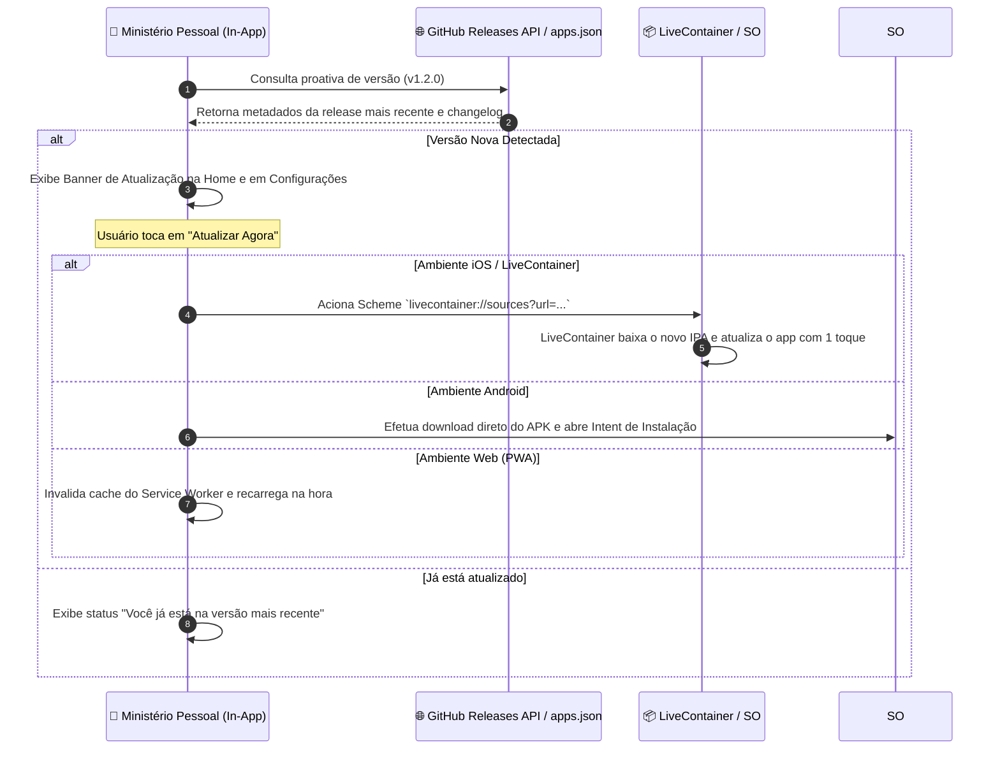
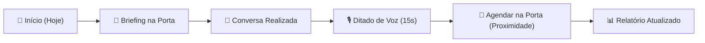

<div align="center">

# 📖 Ministério Pessoal
### *Gestão Eficiente, Discreta e Offline-First do Ministério de Campo*

[-blue?style=for-the-badge&logo=apple&logoColor=white)](https://github.com/eduardoveiga-py/field-assistant/releases/latest)
[](https://flutter.dev)
[](https://dart.dev)
[](https://drift.simonbinder.eu/)
[-brightgreen?style=for-the-badge&logo=checkmarx&logoColor=white)](https://github.com/eduardoveiga-py/field-assistant/actions)
[](https://github.com/eduardoveiga-py/field-assistant/releases)

<p align="center">
  <b>Um aplicativo completo, ágil e focado na rotina ministerial para organizar contatos, revisitas, cursos bíblicos, compromissos, territórios e relatórios mensais.</b><br>
  <i>Funciona 100% offline, sem anúncios, com privacidade absoluta e sincronização multi-dispositivo opcional.</i>
</p>

[📥 Baixar Aplicativo](#-downloads-e-instalação) • [🔄 Atualizações & LiveContainer](#-atualizador-automático--livecontainer-arquitetura) • [✨ Recursos Principais](#-recursos-pensados-para-o-ministério) • [🚀 Guia Rápido de Uso](#-guia-rápido-de-uso) • [🔒 Privacidade e Segurança](#-privacidade-e-segurança-inviolável) • [📋 Detalhes dos Lançamentos](#-histórico-de-lançamentos-e-changelog)

---

</div>

## 📥 Downloads e Instalação

Acesse a página de **[Releases Oficiais](https://github.com/eduardoveiga-py/field-assistant/releases/latest)** e baixe o pacote adequado para o seu dispositivo:

| Plataforma | Pacote | Como Instalar |
| :--- | :--- | :--- |
| **Android** | [`app-arm64-v8a-release.apk`](https://github.com/eduardoveiga-py/field-assistant/releases/latest/download/app-arm64-v8a-release.apk) | Baixe diretamente no aparelho Android, abra o arquivo e confirme a instalação (autorizando fontes desconhecidas se solicitado). |
| **iPhone / iPad** | [`app-release-unsigned.ipa`](https://github.com/eduardoveiga-py/field-assistant/releases/latest/download/app-release-unsigned.ipa) | Instale via **LiveContainer**, **AltStore**, **SideStore**, **TrollStore** ou **Sideloadly** com suporte a atualizações contínuas via catálogo interno ou link direto. |
| **Navegador (Web)** | [`web-release.zip`](https://github.com/eduardoveiga-py/field-assistant/releases/latest/download/web-release.zip) / [Acesso Online (PWA)](https://eduardoveiga-py.github.io/field-assistant/) | Acesse diretamente em [eduardoveiga-py.github.io/field-assistant](https://eduardoveiga-py.github.io/field-assistant/) pelo Chrome, Safari ou Edge e toque em **"Adicionar à Tela de Início"** para instalar como PWA nativo com SQLite Wasm local. |
| **Windows 10/11 (x64)** | [`field-assistant-windows-x64.zip`](https://github.com/eduardoveiga-py/field-assistant/releases/latest/download/field-assistant-windows-x64.zip) | Extraia o `.zip` para uma pasta local e execute `ministerio_pessoal.exe`. |
| **Linux (GTK x64)** | [`field-assistant-linux-x64.tar.gz`](https://github.com/eduardoveiga-py/field-assistant/releases/latest/download/field-assistant-linux-x64.tar.gz) | Extraia o arquivo (`tar -xzf field-assistant-linux-x64.tar.gz`) e execute `./ministerio_pessoal`. |
| **macOS** | [`field-assistant-macos.zip`](https://github.com/eduardoveiga-py/field-assistant/releases/latest/download/field-assistant-macos.zip) | Descompacte o `.zip`, mova o `.app` para a pasta **Aplicativos** e abra o aplicativo. |

### 📱 Fonte Oficial para LiveContainer & AltStore (iOS)

Adicione o Ministério Pessoal diretamente como **Fonte (Source)** no **LiveContainer** ou **SideStore/AltStore** para receber e atualizar o app internamente:

* **URL da Fonte:** `https://github.com/eduardoveiga-py/field-assistant/releases/latest/download/apps.json`
* **Adicionar ao LiveContainer com 1 Toque:** [Toque aqui para abrir no LiveContainer](livecontainer://sources?url=https%3A%2F%2Fgithub.com%2Feduardoveiga-py%2Ffield-assistant%2Freleases%2Flatest%2Fdownload%2Fapps.json)

> [!TIP]
> **Modo Offline Sem Conta**: Você não precisa criar conta nem efetuar login para usar o app! Ao abrir pela primeira vez, toque em **"Continuar em Modo Offline (Sem Conta)"** e o sistema funcionará imediatamente com banco de dados SQLite local no seu aparelho.

---

## 🔄 Atualizador Automático & LiveContainer: Arquitetura

### ❓ É possível criarmos um atualizador automático para nosso app? Ele verifica se tem atualização e atualiza a partir do próprio app, ou sou obrigado a atualizar via LiveContainer?

Esta é uma das perguntas arquiteturais mais importantes no ecossistema iOS e sideloading. A resposta técnica precisa divide-se em duas partes:

#### 1. A Restrição de Sandbox do iOS (Por que nenhum app iOS pode se auto-substituir diretamente)
No iOS (inclusive em aparelhos com sideloading sem jailbreak como LiveContainer, SideStore e AltStore):
- A Apple impõe proteção estrita de memória **W^X** (Write XOR Execute) e validação de assinatura pelo kernel (`amfid` / `seatbelt`).
- O sandbox do sistema operacional **proíbe terminantemente** que um processo em execução sobrescreva seu próprio binário executável (`Mach-O`) em tempo de execução.
- Se um aplicativo tentasse substituir seu próprio executável em disco enquanto está em execução, ocorreria corrupção de memória e encerramento forçado imediato pelo kernel (`SIGKILL`).

#### 2. Como o Ministério Pessoal resolve isso elegantemente (In-App Auto-Update Workflow)
Em vez de forçar o usuário a procurar manualmente no GitHub a cada nova versão, implementamos um **fluxo integrado em dois níveis**:



1. **Checagem Automática Integrada**:
   - O `UpdateCheckerService` verifica a versão na Splash Screen, na tela de Início (Home) e na aba Configurações através da API do GitHub Releases (`/releases/latest`) com fallback para o CDN do `apps.json`.
   - Compara versões usando Semver canônico (`Major.Minor.Patch`).
2. **Aviso Visual com Changelog**:
   - Quando há nova versão, um card visual destacado informa o número da versão, data de lançamento, tamanho do download em MB e notas do lançamento.
3. **Ação de Atualização em 1 Toque**:
   - **No iOS (LiveContainer)**: Tocar em **"Atualizar Agora"** dispara a URL `livecontainer://sources?url=...`, comandando o LiveContainer a baixar a nova compilação e atualizar o app sem esforço manual.
   - **No Android**: O aplicativo baixa o pacote `app-arm64-v8a-release.apk` diretamente e invoca o instalador do sistema operacional.
   - **Na Web**: O Service Worker é atualizado e a página é recarregada instantaneamente.

**Conclusão**: O app verifica tudo internamente e avisa você; para aplicar o novo binário no iOS, ele se comunica com o LiveContainer com 1 único toque, garantindo total conformidade com o sistema sem risco de quebra de assinatura.

---

## ✨ Recursos Pensados para o Ministério

### 🚪 1. Briefing na Porta (30 Segundos)
Antes de bater à porta, consulte rapidamente um resumo estratégico do morador:
- **Onde paramos**: última lição e ponto considerado no livro *Seja Feliz para Sempre!*.
- **Próximo passo acordado**: pergunta pendente ou assunto acordado para a revisita.
- **Toque de empatia**: detalhes pessoais (família, saúde, preferências) para uma conversa calorosa.
- **Data da última visita**: acompanhe com exatidão o tempo decorrido desde o último contato.
- **Link Direto**: abra o parágrafo exato diretamente no **JW Library** ou jw.org com um toque.

---

### 🎙️ 2. Anotação Rápida por Ditado de Voz (15s)
Enquanto caminha entre uma residência e outra, registre tudo sem precisar digitar no teclado:
- Grave e dite uma nota de voz de 15 segundos.
- O motor inteligente extrai o **número da lição**, o **ponto considerado**, o nome do estudante e os detalhes de empatia.
- Os campos do formulário são pré-preenchidos automaticamente para você salvar em menos de 3 toques.

---

### 🗓️ 3. Agenda Inteligente & Feriados Nacionais
- **Anti-Colisão de Horários**: detecta sobreposições de compromissos e sugere horários vagos no mesmo dia.
- **Feriados Brasileiros**: feriados nacionais (fixos e móveis calculados por Páscoa/Carnaval) aparecem destacados no calendário mensal para facilitar o planejamento de saídas de campo.
- **Sincronização Bidirecional**: conecte com Google Calendar e Apple Calendar mantendo eventos sincronizados.

---

### 📍 4. Agendamento de Retorno na Porta por Proximidade
- No perfil do contato, acione o botão **"Agendar Retorno na Porta (Proximidade)"**.
- O motor geodésico analisa:
  - O horário habitual de preferência da pessoa (ex: "Sábado 10:00").
  - A vizinhança geográfica com outros estudos e revisitas agendados para a mesma saída.
  - Buffers de deslocamento a pé (15 min) e veicular.
  - Conflitos com compromissos locais e calendários externos.
- Sugere os melhores horários para confirmar o compromisso com 1 toque.

---

### 🗺️ 5. Territórios Inteligentes & Análise de Cobertura
- **Índice de Cobertura ($IC$)**: cálculo determinístico da porcentagem do território percorrida nos últimos 90 dias:
  $$\text{IC} = \frac{\text{Endereços Trabalhados nos Últimos 90 Dias}}{\text{Total de Endereços Ativos}} \times 100$$
- **Zonas Esquecidas (>90 dias)**: identificação instantânea de residências ou ruas sem visita recente, exibidas com destaque visual no mapa para reativação ordenada do território.
- **Camadas Visuais por Cor**:
  - 🟢 Visitado recentemente (<30 dias)
  - 🟡 No ciclo de revisita (30 a 90 dias)
  - 🟣 Cursos Bíblicos ativos
  - 🔴 Zonas Esquecidas (>90 dias)
- **Mapas Offline**: faça o download dos blocos em níveis de zoom 13 a 17 para navegar em bairros e áreas rurais sem sinal de celular.

---

### 📥 6. Interoperabilidade de Territórios (KML, GeoJSON e CSV)
- **Exportação e Importação Flexível**:
  - **KML 2.2**: compatível com Google Earth, Organic Maps e GPS automotivo.
  - **GeoJSON (RFC 7946)**: formato padrão para SIG (Sistemas de Informação Geográfica) e mapas web.
  - **CSV Universal**: planilha editável no Excel, Google Planilhas ou LibreOffice.
- Exporte pontos com nome, telefone, endereço, notas e coordenadas com um toque na barra de ferramentas do mapa.

---

### 🔍 7. Detecção Inteligente de Endereços Duplicados
- Motor geodésico baseado na fórmula de **Haversine** e similaridade textual (bigramas de Sorensen-Dice).
- Detecta registros cadastrados em duplicidade no território quando:
  - A distância física for inferior a **25 metros** E o nome tiver similaridade $\ge 0.60$ (ou mesmo endereço).
  - O endereço for idêntico e o raio for de até **50 metros**.
- Evita que dois publicadores visitem o mesmo morador por engano.

---

### 🏹 8. Assistente Linguístico & Tradução
- Aba expandida para apoiar publicadores em regiões multilíngues, de fronteira e campos indígenas:
  - **Língua de Referência (Golden Flagship)**: **Ticuna** (*Magüta* / *Tikuna*), falado por dezenas de milhares de irmãos no Alto Solimões e fronteira Brasil-Colômbia-Peru.
  - **Línguas Suportadas**: Português, Ticuna, Espanhol, Guajajara (*Tenetehara*) e Yanomami (*Yanomamõ*).
- **6 Momentos-Chave do Ministério**:
  1. *Saudação Inicial* (cumprimento cordial cultural)
  2. *Leitura Bíblica* (apresentação de textos confortadores)
  3. *Pergunta para Revisita* (questão reflexiva para o retorno)
  4. *Oferta de Estudo* (convite para o curso bíblico)
  5. *Lidando com Objeções* (respostas calmas e respeitosas)
  6. *Despedida Cordial* (fechamento afetuoso)
- **Comparador Multilíngue**: compare expressões lado a lado em Português, Ticuna e Espanhol com guia fonético e áudio de pronúncia nativa.
- **Fichas de Memorização (Algoritmo SM-2)**: modo flashcard com repetição espaçada SuperMemo-2 para memorizar saudações e frases teocráticas.
- **Histórico de Buscas**: acesso rápido aos termos mais pesquisados no campo.

---

### 🌐 9. Internacionalização Nativa (i18n)
- Suporte a múltiplos idiomas na interface do usuário:
  - 🇧🇷 **Português (Brasil)** - Padrão / Golden Master
  - 🇺🇸 **English (US)**
  - 🇪🇸 **Español**
- Catálogo tipado e seguro (`AppLocaleStrings`) com fallback automático para Português em caso de termos não traduzidos.
- Seletor de idioma em tempo real na aba **Configurações**.

---

### 🎨 10. Identidade Visual Conectada & Saudações Dinâmicas
- **Hero Chromatic Accent Band**: barra cromática elegante no topo das telas secundárias, harmonizada com as cores dos cards da tela de Início:
  - 🟣 Estudos Bíblicos (Roxo Teocrático)
  - 🔵 Pessoas e Contatos (Azul Ministerial)
  - 🟡 Agenda de Retornos (Âmbar Solar)
  - 🟢 Idiomas & Tradução (Verde Esmeralda / Floresta)
  - 🔷 Mapas & Territórios (Índigo Profundo)
- **Saudação Dinâmica Contextual**: mensagem calorosa adaptada ao momento do dia (manhã, tarde, noite) com container translúcido glassmorphic na tela inicial.

---

### ☀️ 11. Modo Sol Intenso (Alto Contraste WCAG AAA)
- Sob a luz forte do sol no campo, ative o **Modo Sol** no topo da tela com 1 toque.
- Ajusta instantaneamente contraste de fontes, ícones e bordas escuras sem sombras suaves, eliminando reflexos incômodos sob o sol do meio-dia.

---

### 📊 12. Relatórios & Contagem Rigorosa
- Regras de contagem transparentes e alinhadas às diretrizes oficiais:
  - Casais ou famílias estudando juntos contam exatamente como **1 estudo bíblico**.
  - Apenas sessões de estudo efetivamente realizadas somam no mês.
  - Tentativas sem contato não são computadas como conversas.
- Acompanhamento do **Ritmo de Pioneiro** para planejar e atingir metas de horas com serenidade.

---

### 🔐 13. Sincronização Multi-Dispositivo & Offline-First
- Funciona 100% offline em qualquer lugar remoto.
- Ao conectar sua conta no Supabase, o app sincroniza automaticamente todas as tabelas na Splash Screen com fila persistente e resolução de conflitos idempotente.

---

### 📋 14. Tarefas & Projetos com Pesquisa, Tags, Filtros e Descrição Visível
- **Pesquisa e Filtros Ágeis**: barra de pesquisa dedicada combinada com filtros rápidos por prioridade, categoria e tags.
- **Descrição Visível no Card**: a descrição detalhada das tarefas agora é exibida diretamente no card da tarefa (resolvendo o problema de visualização truncada), acompanhada de badges de prazos e tags.
- **Editor Rico com Markdown & Imagens**: criação e edição de tarefas e projetos agora contam com o `RichMarkdownToolbar` completo, permitindo formatação avançada, listas e inclusão de imagens.
- **Anexos Universais**: tarefas suportam anexos com abertura direta no Visualizador Universal.

---

### 📧 15. Inbox, E-mail Teocrático (JW Pub) & Trava Biométrica Global
- **Trava Biométrica em Toda a Aba Inbox**: proteção integral de segurança (Face ID / Touch ID / PIN) exigida logo ao abrir a tela de Inbox, protegendo capturas, notas, e-mails e cartas.
- **Configuração IMAP JW.org nas Configurações**: formulário completo para sincronização com o e-mail teocrático (`mail.jw.org`, porta `993`, com credenciais salvas de forma segura no banco local e botão "Testar Conexão e Salvar").
- **Edição Completa de Capturas**: qualquer item capturado no Inbox pode ser editado (conteúdo, categoria, metadados) via modal dedicado.
- **Retenção Permanente Imune à Purga**: mensagens e correspondências permanecem salvas localmente no Drift SQLite, imunes à purga remota de 90 dias do servidor.
- **Visualização Universal de Anexos**: qualquer anexo de e-mail ou nota abre diretamente no leitor nativo integrado.

---

### 📚 16. Base de Conhecimento: Tags, Clamping, Leitor Imersivo & Correção de PDFs
- **Tags e Filtros**: suporte completo a tags com chips interativos para filtrar Notas, Dúvidas, Documentos e Recursos.
- **Cards com Altura Máxima Clamped**: visual organizado e compacto que nunca transborda verticalmente.
- **Leitor Dedicado em Modal (`showKnowledgeItemReader`)**: ao clicar em qualquer card, abre-se uma tela imersiva de leitura com Markdown estilizado, imagens inline, badges de links e tags.
- **Correção Definitiva de Leitura de PDFs**: visualizador com fallback inteligente integrado via `PdfPreview` (pacote `printing`), permitindo visualizar qualquer PDF local sem depender de aplicativos externos falharem.
- **Editor Rico em Dúvidas e Recursos**: `RichMarkdownToolbar` incorporado em todas as seções para formatação de texto, imagens e links teocráticos.

---

### 📖 17. Estudos Bíblicos: Pesquisa, Filtros, Tags e Cards Recolhíveis/Expandíveis
- **Cards Recolhíveis e Expansíveis (1 Toque)**: economize espaço vertical de forma dramática no celular ou tablet. Em modo compacto, os cards mostram avatar, estudante, publicação, lição/parágrafo e badges essenciais. Ao tocar, expandem suavemente para exibir participantes, histórico de lições e botões de ação.
- **Expandir / Recolher Todos**: botão no topo da lista para alternar todos os estudos simultaneamente.
- **Pesquisa em Tempo Real**: localize rapidamente qualquer estudo por nome do estudante, título, publicação ou tags.
- **Filtros por Publicação e Tags**: filtre por publicação específica (*Seja Feliz para Sempre!* livro ou brochura) e por marcadores/metas teocráticas (#Batismo, #Família, etc.).
- **Gestão de Tags de Estudo**: campos dedicados para definir marcadores tanto na criação quanto na edição do estudo bíblico.

---

### 🖼️ 18. Visualizador Universal de Anexos
- **Suporte Multiformato Nativo em Todo o App**:
  - 📄 **PDFs**: renderizados de forma nítida com navegação de páginas e zoom via `PdfPreview`.
  - 🖼️ **Imagens (JPG, PNG, WebP)**: visualização em tela cheia com zoom interativo por pinça (`InteractiveViewer`) e rotação.
  - 🎵 **Áudio (M4A, MP3, WAV, AAC)**: reprodutor de áudio integrado com barra de progresso, botão play/pause e tempo decorrido.
  - 📝 **Documentos de Texto e Markdown**: visualizador monospaçado estilizado com botão de cópia.
  - 🔗 **Fallback do Sistema**: opção "Abrir em App Externo" integrada para formatos complementares.

---

### ✍️ 19. Editor Rico com Imagens Inline & Links Teocráticos (JW.org)
- **Barra de Formatação `RichMarkdownToolbar`**:
  - 🖼️ **Inserir Imagem**: escolha da galeria, câmera ou URL, inserindo sintaxe de markdown ``.
  - 📖 **Inserir Link de Publicação / Vídeo**: insere links formatados para jw.org e JW Library (`[📖 Título](url)` ou `[🎥 Título](url)`).
  - Suporte completo em Experiências no Ministério, Notas, Tarefas, Projetos, Dúvidas e Recursos.

---

### 🔒 20. Google Calendar: Persistência de Sessão e Eliminação de Popups Recorrentes
- **Sessão Persistente**: a conta Google selecionada fica armazenada em cache persistente local (`AppKvStore`), evitando que a janela de seleção de conta do Google seja exibida repetidamente ao navegar no aplicativo.
- **Gerenciamento em Configurações**: a aba Configurações permite visualizar a conta atualmente conectada, alternar de conta com 1 toque ("Trocar") ou desconectar ("Desconectar").
- **Chamadas Silenciosas**: sincronizações em segundo plano utilizam verificação não intrusiva (`promptIfNecessary: false`), garantindo paz ao usuário durante o uso do aplicativo.

---

### 🎓 21. Fotos e Avatares de Estudantes Bíblicos
- **Consistência Visual**: na aba **Estudos Bíblicos**, cada card de estudante exibe a foto do estudante ou seu avatar circular com iniciais, exatamente idêntico à aba **Pessoas**.
- **Resiliência na Busca**: suporte a vínculo por participante ou correspondência direta do nome do estudante/morador com fotos cadastradas.
- Presente tanto na visualização priorizada (Visão Geral de Progresso) quanto na lista completa de estudos ativos e concluídos.

---

### 🛡️ 22. Exclusão Definitiva de Pessoa e Contatos com Janela Informativa de 5 Pontos
- **Segurança Relacional e Integridade**: ao solicitar a exclusão de qualquer pessoa, o diálogo transparente `PersonDeletionDialog` detalha com clareza os **5 pontos do ciclo de vida**:
  1. *Liberação Atômica da Agenda*: cancelamento de revisitas e compromissos futuros vinculados.
  2. *Encerramento de Estudos Bíblicos*: finalização segura de estudos com status "Interrompido" ou desvinculação limpa.
  3. *Preservação Histórica*: histórico de conversas passadas e relatórios de campo anteriores permanecem preservados para contagem ministerial.
  4. *Limpeza Local de Mídia*: remoção segura da foto local e desassociação de contatos telefônicos rápidos.
  5. *Tombstones e Sincronização Conflito-Zero*: emissão de registros de remoção no Drift SQLite com garantia de propagação segura ao Supabase.

---

### ⚡ 23. Liberação Atômica da Agenda ao Encerrar ou Excluir
- **Coordenação Transacional (`ScheduleReleaseCoordinator`)**:
  - Cancelamento em cascata imediato de compromissos pendentes no banco local.
  - Cancelamento de alertas e notificações agendadas via `LocalReminderService`.
  - Remoção automática de eventos sincronizados nos provedores externos (Google Calendar e Apple EventKit).
  - Execução atômica sem estados intermediários órfãos ou notificações fantasmas na barra de status.

---

### 🗺️ 24. Map Engine Nível 2: Alto Solimões Canônico & Fallback Raster
- **Cartografia Vetorial Offline de Precisão**:
  - Pacotes vetoriais MBTiles cobrindo os municípios de **Betânia** e **Santo Antônio do Içá** com camadas hidrográficas, eixos viários e setores censitários do Alto Solimões.
  - Servidor loopback local RFC 7233 para streaming de tiles vetoriais sem consumo de dados móveis.
  - **Fallback Dinâmico de Alta Disponibilidade (`RasterFallbackAdapter`)**: transição automática e imperceptível para camadas raster cacheadas em dispositivos legados ou sem suporte a aceleração gráfica por hardware (Metal/Vulkan).
  - Layout totalmente responsivo com suporte a rotação horizontal no iPad e modo compacto no iPhone.

---

### 📬 25. Sistema de E-mails Exchange / JWPUB / Multi-Contas
- **Experiência de Comunicação Ministerial Profissional**:
  - Navegação completa por caixas postais: **Caixa de Entrada**, **Enviados**, **Rascunhos** e **Lixeira**.
  - **Compositor Limpo e Profissional**: remoção de estilos/marcações indesejadas e formatação tipográfica padronizada.
  - **Gerenciador de Contatos Inteligente (`EmailContactsManager`)**: auto-completar instantâneo de endereços conforme digitação e salvamento automático de novos destinatários.
  - **Anexos Integrados**: download direto e pré-visualização no Visualizador Universal de Anexos sem depender de clientes de terceiros.
  - Proteção por autenticação biométrica local e retenção permanente contra expiração remota de servidores.

---

### 🎨 26. Banco de Gravuras Interativo com Super Zoom de até 10x
- **Galeria Ministerial de Imagens e Ilustrações Teocráticas**:
  - Catálogo organizado por marcadores e temas práticos para demonstrações na pregação de casa em casa e no carrinho.
  - **Visualizador em Tela Cheia com Zoom de 10x**: implementado com `InteractiveViewer(minScale: 0.5, maxScale: 10.0)`, permitindo examinar com máxima fidelidade infográficos, mapas bíblicos e detalhes de gravuras em qualquer condição de iluminação no ministério.

---

### 💎 27. Ícones Dinâmicos & Badges Cromáticos na Navegação Shell
- **Nova Identidade Visual da Barra Inferior e NavigationRail**:
  - Badges cromáticos destacados com bordas suaves e tonalidades específicas para cada módulo ministerial.
  - Alternância inteligente entre ícones delineados (*outlined*) no estado inativo e preenchidos (*filled*) no estado ativo.
  - Indicador de seleção translúcido e sem interferência de contraste, garantindo clareza total tanto no tema claro quanto no tema escuro.

---

## 🚀 Guia Rápido de Uso



1. **Adicionar Contato**:
   Na aba **Pessoas**, toque em `+` e informe o nome, endereço e preferências do morador.
2. **Iniciar um Estudo Bíblico**:
   No perfil da pessoa, vincule o curso bíblico com a publicação *Seja Feliz para Sempre!*. O app acompanhará o progresso de cada lição.
3. **Registrar Visita**:
   Após falar com a pessoa, abra a tela dela ou use o ditado de voz. Confirme o que foi considerado e defina a data de retorno.
4. **Agendar Retorno na Porta**:
   Toque em *Agendar Retorno na Porta (Proximidade)* para receber sugestões de horários sem colisão e otimizar a rota de retorno.
5. **Fechar o Mês**:
   Na aba **Atividades**, veja o total de horas, publicações entregues, vídeos mostrados, revisitas e estudos bíblicos prontos para envio.

---

## 🔒 Privacidade e Segurança Inviolável

- 🛡️ **Zero Telemetria / Sem Anúncios**: Seus contatos ministeriais e anotações pertencem apenas a você.
- 🔐 **Backups Criptografados de Ponta a Ponta**:
  - Criptografia militar **AES-256 GCM** com derivação de chave **PBKDF2** (100.000 iterações).
  - Exporte seu arquivo de backup com senha pessoal e restaure em qualquer aparelho.
- 📴 **100% Offline-First**: O banco de dados SQLite reside fisicamente na memória do seu próprio telefone.

---

## 📋 Histórico de Lançamentos e Changelog

> **Versão Homologada Atual:** **v2.1.0 (Build 15)** — Data de Lançamento: **21/11/2026** *(versão 2.0.0 lançada em 18/11/2026 e consolidada em 20/11/2026)*.

As notas de atualização detalhadas de cada lançamento foram retiradas do README principal e organizadas em documento próprio e anexadas a cada release:

- 📦 **[Releases Oficiais no GitHub](https://github.com/eduardoveiga-py/field-assistant/releases)**: Download dos pacotes oficiais para todas as plataformas (Android APK, iOS unsigned IPA, Web PWA, Windows x64, Linux x64 e macOS) e notas de versão de cada lançamento.
- 📜 **[CHANGELOG.md](CHANGELOG.md)**: Histórico completo, auditável e detalhado de todas as versões desde a versão 1.0.0 até a versão 2.1.0.

### 🚀 Destaques do Lançamento 2.1.0 (21/11/2026)
- **🎨 Redesign Minimalista Profissional**: Design system moderno e sóbrio (estilo Linear e Apple HIG) no Dark Mode e Light Mode, barra de navegação/sidebar com pills translúcidas e tela "Hoje no Ministério" limpa com tipografia hierárquica e cards de atalho 40x40.
- **🗺️ Map Engine Padrão Organic Maps**: Estilos vetoriais claros (`organic_maps_light.json`) e escuros (`organic_maps_dark.json`), suporte a overzoom offline sem telas pretas e gestos de pinça (pinch-to-zoom) aprimorados no iOS.
- **📬 Caixa de Entrada & E-mails Pro**: Filtros inteligentes na Inbox, correções no fluxo de envio Exchange ActiveSync multi-contas e guarda no loop de SyncKey.
- **🎨 Banco de Gravuras**: Exclusão rápida integrada e visualizador interativo em tela cheia com zoom contínuo de até 10x.
- **🛡️ Estabilidade & Qualidade**: Correção definitiva do teste de integração SMTP intermitente, concorrência de pipeline CI e scripts pré-push padronizados.

---


## 🛠️ Desenvolvimento e Compilação

<details>
<summary><b>Clique para expandir instruções técnicas para desenvolvedores</b></summary>
<br>

### Pré-requisitos
- **Flutter SDK**: 3.27+ (canal estável).
- **Dart SDK**: 3.5+.
- **Java JDK**: 17 (Zulu ou OpenJDK).

### Instalação e Execução
```bash
# 1. Clonar repositório e obter dependências
git clone https://github.com/eduardoveiga-py/field-assistant.git
cd field-assistant
flutter pub get

# 2. Gerar código do banco Drift e Riverpod
dart run build_runner build --delete-conflicting-outputs

# 3. Executar em desenvolvimento
flutter run -d chrome      # Navegador Web
flutter run -d windows     # Desktop Windows
flutter run -d <device-id> # Dispositivo Android / iOS
```

### Qualidade de Código e Testes
```bash
# Análise estática obrigatória (zero warnings/erros)
dart analyze lib test integration_test --fatal-warnings

# Suíte completa de testes automatizados com cobertura
flutter test --coverage
```

### Compilação de Produção
```bash
# Web SPA com SQLite Wasm
flutter build web --release

# Android APK
flutter build apk --release

# iOS (binário de release sem assinatura para LiveContainer/AltStore)
flutter build ios --no-codesign --release
```

### Estrutura de Pastas
```
lib/
  ├── core/            # AppVersion, AppTheme, i18n, logging e utilitários
  ├── database/        # Drift ORM (SQLite / Wasm) e repositório de dados
  ├── appointments/    # Motor de agenda, colisões, feriados e agendamento por proximidade
  ├── contacts/        # Briefing na porta e gerenciamento de pessoas
  ├── studies/         # Gestão de cursos bíblicos, lições e sessões
  ├── voice_notes/     # Gravador de áudio e parser inteligente determinístico
  ├── territory/       # Cobertura ($IC$), zonas esquecidas, KML/GeoJSON e azulejos offline
  ├── ticuna/          # Assistente de idiomas, 6 momentos, catálogo e repetição SM-2
  ├── sync/            # Protocolo de sincronização offline com Supabase
  └── ui/              # Telas adaptativas, componentes e temas visuais
```

</details>

---

## 📄 Licença

Distribuído sob a **[Licença MIT](LICENSE)** — uso pessoal, comunitário, fork e contribuições são bem-vindos.

> Este projeto é desenvolvido de forma voluntária e gratuita para apoiar a organização do serviço cristão de pregação. Não possui afiliação oficial com nenhuma organização religiosa.

---

## 🧪 Testes do Banco de Dados Supabase (pgTAP)

As políticas de segurança RLS, as RPCs E2EE e os buckets de Storage são validados via **pgTAP** diretamente no Supabase:

```bash
# Pré-requisito: Supabase CLI instalado e linkado ao projeto
supabase login
supabase link --project-ref SEU_PROJECT_REF

# Executar suíte de testes (24 asserções de segurança)
supabase test db

# Ou contra banco local (docker):
supabase start
supabase test db
```

Os testes ficam em `supabase/tests/01_rls_e2ee_storage_security.sql` e validam:
- Isolamento de contas (user_a não enxerga dados de user_b)
- Bloqueio total do role `anon`
- Acesso exclusivo via RPC CAS (sem INSERT direto)
- Detecção de conflito em revisão obsoleta
- Privacidade dos 4 buckets de Storage (`voice_notes`, `ticuna_audio`, `knowledge_vault`, `person_photos`)


