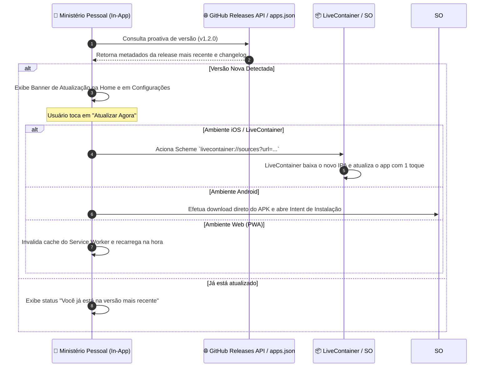
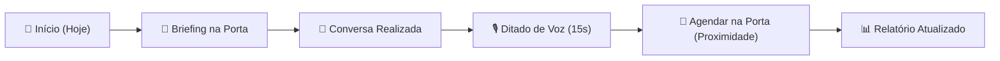

<div align="center">

# 📖 Ministério Pessoal
### *Gestão Eficiente, Discreta e Offline-First do Ministério de Campo*

[-blue?style=for-the-badge&logo=apple&logoColor=white)](https://github.com/eduardoveiga-py/field-assistant/releases/latest)
[](https://flutter.dev)
[](https://dart.dev)
[](https://drift.simonbinder.eu/)
[-brightgreen?style=for-the-badge&logo=checkmarx&logoColor=white)](https://github.com/eduardoveiga-py/field-assistant/actions)
[](https://github.com/eduardoveiga-py/field-assistant/releases)

<p align="center">
  <b>Um aplicativo completo, ágil e focado na rotina ministerial para organizar contatos, revisitas, cursos bíblicos, compromissos, territórios e relatórios mensais.</b><br>
  <i>Funciona 100% offline, sem anúncios, com privacidade absoluta e sincronização multi-dispositivo opcional.</i>
</p>

[📥 Baixar Aplicativo](#-downloads-e-instalação) • [🔄 Atualizações & LiveContainer](#-atualizador-automático--livecontainer-arquitetura) • [✨ Recursos Principais](#-recursos-pensados-para-o-ministério) • [🚀 Guia Rápido de Uso](#-guia-rápido-de-uso) • [🔒 Privacidade e Segurança](#-privacidade-e-segurança-inviolável) • [📋 Detalhes dos Lançamentos](#-histórico-de-lançamentos-e-changelog)

---

</div>

## 📥 Downloads e Instalação

Acesse a página de **[Releases Oficiais](https://github.com/eduardoveiga-py/field-assistant/releases/latest)** e baixe o pacote adequado para o seu dispositivo:

| Plataforma | Pacote | Como Instalar |
| :--- | :--- | :--- |
| **Android** | [`app-arm64-v8a-release.apk`](https://github.com/eduardoveiga-py/field-assistant/releases/latest/download/app-arm64-v8a-release.apk) | Baixe diretamente no aparelho Android, abra o arquivo e confirme a instalação (autorizando fontes desconhecidas se solicitado). |
| **iPhone / iPad** | [`app-release-unsigned.ipa`](https://github.com/eduardoveiga-py/field-assistant/releases/latest/download/app-release-unsigned.ipa) | Instale via **LiveContainer**, **AltStore**, **SideStore**, **TrollStore** ou **Sideloadly** com suporte a atualizações contínuas via catálogo interno ou link direto. |
| **Navegador (Web)** | `web-release.zip` / Acesso Online | Acesse diretamente pelo Chrome, Safari ou Edge e toque em **"Adicionar à Tela de Início"** para instalar como PWA nativo com SQLite Wasm local. |

### 📱 Fonte Oficial para LiveContainer & AltStore (iOS)

Adicione o Ministério Pessoal diretamente como **Fonte (Source)** no **LiveContainer** ou **SideStore/AltStore** para receber e atualizar o app internamente:

* **URL da Fonte:** `https://cdn.jsdelivr.net/gh/eduardoveiga-py/field-assistant@master/apps.json`
* **Adicionar ao LiveContainer com 1 Toque:** [Toque aqui para abrir no LiveContainer](livecontainer://sources?url=https://cdn.jsdelivr.net/gh/eduardoveiga-py/field-assistant@master/apps.json)

> [!TIP]
> **Modo Offline Sem Conta**: Você não precisa criar conta nem efetuar login para usar o app! Ao abrir pela primeira vez, toque em **"Continuar em Modo Offline (Sem Conta)"** e o sistema funcionará imediatamente com banco de dados SQLite local no seu aparelho.

---

## 🔄 Atualizador Automático & LiveContainer: Arquitetura

### ❓ É possível criarmos um atualizador automático para nosso app? Ele verifica se tem atualização e atualiza a partir do próprio app, ou sou obrigado a atualizar via LiveContainer?

Esta é uma das perguntas arquiteturais mais importantes no ecossistema iOS e sideloading. A resposta técnica precisa divide-se em duas partes:

#### 1. A Restrição de Sandbox do iOS (Por que nenhum app iOS pode se auto-substituir diretamente)
No iOS (inclusive em aparelhos com sideloading sem jailbreak como LiveContainer, SideStore e AltStore):
- A Apple impõe proteção estrita de memória **W^X** (Write XOR Execute) e validação de assinatura pelo kernel (`amfid` / `seatbelt`).
- O sandbox do sistema operacional **proíbe terminantemente** que um processo em execução sobrescreva seu próprio binário executável (`Mach-O`) em tempo de execução.
- Se um aplicativo tentasse substituir seu próprio executável em disco enquanto está em execução, ocorreria corrupção de memória e encerramento forçado imediato pelo kernel (`SIGKILL`).

#### 2. Como o Ministério Pessoal resolve isso elegantemente (In-App Auto-Update Workflow)
Em vez de forçar o usuário a procurar manualmente no GitHub a cada nova versão, implementamos um **fluxo integrado em dois níveis**:



1. **Checagem Automática Integrada**:
   - O `UpdateCheckerService` verifica a versão na Splash Screen, na tela de Início (Home) e na aba Configurações através da API do GitHub Releases (`/releases/latest`) com fallback para o CDN do `apps.json`.
   - Compara versões usando Semver canônico (`Major.Minor.Patch`).
2. **Aviso Visual com Changelog**:
   - Quando há nova versão, um card visual destacado informa o número da versão, data de lançamento, tamanho do download em MB e notas do lançamento.
3. **Ação de Atualização em 1 Toque**:
   - **No iOS (LiveContainer)**: Tocar em **"Atualizar Agora"** dispara a URL `livecontainer://sources?url=...`, comandando o LiveContainer a baixar a nova compilação e atualizar o app sem esforço manual.
   - **No Android**: O aplicativo baixa o pacote `app-arm64-v8a-release.apk` diretamente e invoca o instalador do sistema operacional.
   - **Na Web**: O Service Worker é atualizado e a página é recarregada instantaneamente.

**Conclusão**: O app verifica tudo internamente e avisa você; para aplicar o novo binário no iOS, ele se comunica com o LiveContainer com 1 único toque, garantindo total conformidade com o sistema sem risco de quebra de assinatura.

---

## ✨ Recursos Pensados para o Ministério

### 🚪 1. Briefing na Porta (30 Segundos)
Antes de bater à porta, consulte rapidamente um resumo estratégico do morador:
- **Onde paramos**: última lição e ponto considerado no livro *Seja Feliz para Sempre!*.
- **Próximo passo acordado**: pergunta pendente ou assunto acordado para a revisita.
- **Toque de empatia**: detalhes pessoais (família, saúde, preferências) para uma conversa calorosa.
- **Data da última visita**: acompanhe com exatidão o tempo decorrido desde o último contato.
- **Link Direto**: abra o parágrafo exato diretamente no **JW Library** ou jw.org com um toque.

---

### 🎙️ 2. Anotação Rápida por Ditado de Voz (15s)
Enquanto caminha entre uma residência e outra, registre tudo sem precisar digitar no teclado:
- Grave e dite uma nota de voz de 15 segundos.
- O motor inteligente extrai o **número da lição**, o **ponto considerado**, o nome do estudante e os detalhes de empatia.
- Os campos do formulário são pré-preenchidos automaticamente para você salvar em menos de 3 toques.

---

### 🗓️ 3. Agenda Inteligente & Feriados Nacionais
- **Anti-Colisão de Horários**: detecta sobreposições de compromissos e sugere horários vagos no mesmo dia.
- **Feriados Brasileiros**: feriados nacionais (fixos e móveis calculados por Páscoa/Carnaval) aparecem destacados no calendário mensal para facilitar o planejamento de saídas de campo.
- **Sincronização Bidirecional**: conecte com Google Calendar e Apple Calendar mantendo eventos sincronizados.

---

### 📍 4. Agendamento de Retorno na Porta por Proximidade
- No perfil do contato, acione o botão **"Agendar Retorno na Porta (Proximidade)"**.
- O motor geodésico analisa:
  - O horário habitual de preferência da pessoa (ex: "Sábado 10:00").
  - A vizinhança geográfica com outros estudos e revisitas agendados para a mesma saída.
  - Buffers de deslocamento a pé (15 min) e veicular.
  - Conflitos com compromissos locais e calendários externos.
- Sugere os melhores horários para confirmar o compromisso com 1 toque.

---

### 🗺️ 5. Territórios Inteligentes & Análise de Cobertura
- **Índice de Cobertura ($IC$)**: cálculo determinístico da porcentagem do território percorrida nos últimos 90 dias:
  $$\text{IC} = \frac{\text{Endereços Trabalhados nos Últimos 90 Dias}}{\text{Total de Endereços Ativos}} \times 100$$
- **Zonas Esquecidas (>90 dias)**: identificação instantânea de residências ou ruas sem visita recente, exibidas com destaque visual no mapa para reativação ordenada do território.
- **Camadas Visuais por Cor**:
  - 🟢 Visitado recentemente (<30 dias)
  - 🟡 No ciclo de revisita (30 a 90 dias)
  - 🟣 Cursos Bíblicos ativos
  - 🔴 Zonas Esquecidas (>90 dias)
- **Mapas Offline**: faça o download dos blocos em níveis de zoom 13 a 17 para navegar em bairros e áreas rurais sem sinal de celular.

---

### 📥 6. Interoperabilidade de Territórios (KML, GeoJSON e CSV)
- **Exportação e Importação Flexível**:
  - **KML 2.2**: compatível com Google Earth, Organic Maps e GPS automotivo.
  - **GeoJSON (RFC 7946)**: formato padrão para SIG (Sistemas de Informação Geográfica) e mapas web.
  - **CSV Universal**: planilha editável no Excel, Google Planilhas ou LibreOffice.
- Exporte pontos com nome, telefone, endereço, notas e coordenadas com um toque na barra de ferramentas do mapa.

---

### 🔍 7. Detecção Inteligente de Endereços Duplicados
- Motor geodésico baseado na fórmula de **Haversine** e similaridade textual (bigramas de Sorensen-Dice).
- Detecta registros cadastrados em duplicidade no território quando:
  - A distância física for inferior a **25 metros** E o nome tiver similaridade $\ge 0.60$ (ou mesmo endereço).
  - O endereço for idêntico e o raio for de até **50 metros**.
- Evita que dois publicadores visitem o mesmo morador por engano.

---

### 🏹 8. Assistente Linguístico & Tradução
- Aba expandida para apoiar publicadores em regiões multilíngues, de fronteira e campos indígenas:
  - **Língua de Referência (Golden Flagship)**: **Ticuna** (*Magüta* / *Tikuna*), falado por dezenas de milhares de irmãos no Alto Solimões e fronteira Brasil-Colômbia-Peru.
  - **Línguas Suportadas**: Português, Ticuna, Espanhol, Guajajara (*Tenetehara*) e Yanomami (*Yanomamõ*).
- **6 Momentos-Chave do Ministério**:
  1. *Saudação Inicial* (cumprimento cordial cultural)
  2. *Leitura Bíblica* (apresentação de textos confortadores)
  3. *Pergunta para Revisita* (questão reflexiva para o retorno)
  4. *Oferta de Estudo* (convite para o curso bíblico)
  5. *Lidando com Objeções* (respostas calmas e respeitosas)
  6. *Despedida Cordial* (fechamento afetuoso)
- **Comparador Multilíngue**: compare expressões lado a lado em Português, Ticuna e Espanhol com guia fonético e áudio de pronúncia nativa.
- **Fichas de Memorização (Algoritmo SM-2)**: modo flashcard com repetição espaçada SuperMemo-2 para memorizar saudações e frases teocráticas.
- **Histórico de Buscas**: acesso rápido aos termos mais pesquisados no campo.

---

### 🌐 9. Internacionalização Nativa (i18n)
- Suporte a múltiplos idiomas na interface do usuário:
  - 🇧🇷 **Português (Brasil)** - Padrão / Golden Master
  - 🇺🇸 **English (US)**
  - 🇪🇸 **Español**
- Catálogo tipado e seguro (`AppLocaleStrings`) com fallback automático para Português em caso de termos não traduzidos.
- Seletor de idioma em tempo real na aba **Configurações**.

---

### 🎨 10. Identidade Visual Conectada & Saudações Dinâmicas
- **Hero Chromatic Accent Band**: barra cromática elegante no topo das telas secundárias, harmonizada com as cores dos cards da tela de Início:
  - 🟣 Estudos Bíblicos (Roxo Teocrático)
  - 🔵 Pessoas e Contatos (Azul Ministerial)
  - 🟡 Agenda de Retornos (Âmbar Solar)
  - 🟢 Idiomas & Tradução (Verde Esmeralda / Floresta)
  - 🔷 Mapas & Territórios (Índigo Profundo)
- **Saudação Dinâmica Contextual**: mensagem calorosa adaptada ao momento do dia (manhã, tarde, noite) com container translúcido glassmorphic na tela inicial.

---

### ☀️ 11. Modo Sol Intenso (Alto Contraste WCAG AAA)
- Sob a luz forte do sol no campo, ative o **Modo Sol** no topo da tela com 1 toque.
- Ajusta instantaneamente contraste de fontes, ícones e bordas escuras sem sombras suaves, eliminando reflexos incômodos sob o sol do meio-dia.

---

### 📊 12. Relatórios & Contagem Rigorosa
- Regras de contagem transparentes e alinhadas às diretrizes oficiais:
  - Casais ou famílias estudando juntos contam exatamente como **1 estudo bíblico**.
  - Apenas sessões de estudo efetivamente realizadas somam no mês.
  - Tentativas sem contato não são computadas como conversas.
- Acompanhamento do **Ritmo de Pioneiro** para planejar e atingir metas de horas com serenidade.

---

### 🔐 13. Sincronização Multi-Dispositivo & Offline-First
- Funciona 100% offline em qualquer lugar remoto.
- Ao conectar sua conta no Supabase, o app sincroniza automaticamente todas as tabelas na Splash Screen com fila persistente e resolução de conflitos idempotente.

---

## 🚀 Guia Rápido de Uso



1. **Adicionar Contato**:
   Na aba **Pessoas**, toque em `+` e informe o nome, endereço e preferências do morador.
2. **Iniciar um Estudo Bíblico**:
   No perfil da pessoa, vincule o curso bíblico com a publicação *Seja Feliz para Sempre!*. O app acompanhará o progresso de cada lição.
3. **Registrar Visita**:
   Após falar com a pessoa, abra a tela dela ou use o ditado de voz. Confirme o que foi considerado e defina a data de retorno.
4. **Agendar Retorno na Porta**:
   Toque em *Agendar Retorno na Porta (Proximidade)* para receber sugestões de horários sem colisão e otimizar a rota de retorno.
5. **Fechar o Mês**:
   Na aba **Atividades**, veja o total de horas, publicações entregues, vídeos mostrados, revisitas e estudos bíblicos prontos para envio.

---

## 🔒 Privacidade e Segurança Inviolável

- 🛡️ **Zero Telemetria / Sem Anúncios**: Seus contatos ministeriais e anotações pertencem apenas a você.
- 🔐 **Backups Criptografados de Ponta a Ponta**:
  - Criptografia militar **AES-256 GCM** com derivação de chave **PBKDF2** (100.000 iterações).
  - Exporte seu arquivo de backup com senha pessoal e restaure em qualquer aparelho.
- 📴 **100% Offline-First**: O banco de dados SQLite reside fisicamente na memória do seu próprio telefone.

---

## 📋 Histórico de Lançamentos e Changelog

### 🚀 Versão 1.2.0 (Build 5) — 08/11/2026
- **Centralização de Versão**:
  - Criação da classe `AppVersion` em `lib/core/app_version.dart` como fonte única da verdade para versão (`1.2.0`), compilação (`5`), release date, User-Agent canônico e esquemas do LiveContainer.
- **Atualizador Automático In-App**:
  - Implementação do `UpdateCheckerService` com consulta ao GitHub Releases API e fallback via CDN do `apps.json`.
  - Banner visual inteligente na Splash Screen, na tela de Início (Home) e em Configurações, exibindo notas da versão e tamanho em MB.
  - Ação em 1 toque conectada ao esquema oficial `livecontainer://sources?url=...` no iOS, download direto de APK no Android e reload de Service Worker na Web.
- **Assistente Teocrático de Idiomas & Tradução**:
  - Expansão do módulo com `LanguageRegistry` suportando Ticuna (golden flagship), Português, Espanhol, Guajajara e Yanomami.
  - 6 Momentos-Chave do ministério com frases situacionais, guias fonéticos e áudios de pronúncia.
  - Comparador multilíngue e modo Flashcards com repetição espaçada SM-2 (SuperMemo-2).
  - Histórico persistente de pesquisas recentes.
- **Internacionalização (i18n)**:
  - Catálogo tipado `AppLocaleStrings` com suporte a Português (Brasil), Inglês (US) e Espanhol com fallback automático.
  - Seletor dinâmico de idiomas em Configurações.
- **Território Inteligente & Análise de Cobertura**:
  - Cálculo do Índice de Cobertura ($IC$) nos últimos 90 dias.
  - Identificação e overlay de Zonas Esquecidas (>90 dias sem visita).
  - Detecção automática de endereços duplicados por proximidade geodésica (<25m Haversine) e similaridade textual de bigramas.
  - Exportação e importação completa em KML 2.2, GeoJSON (RFC 7946) e CSV.
- **Agendamento de Retorno na Porta por Proximidade**:
  - Botão de 1 toque no perfil do contato (`DoorstepReturnBookingDialog`).
  - Motor de cálculo de horários com base em preferências habituais, proximidade física de outros estudos e buffers de deslocamento.
  - Detecção automática de conflitos com agenda local e calendários externos.
- **Identidade Visual Conectada**:
  - Componente `ScreenHeroAccentBand` integrando as cores dos cards da Home com as barras de navegação das telas secundárias.
  - Saudação dinâmica contextual conforme o período do dia (manhã, tarde, noite) com efeito glassmorphic.
- **CI/CD Paralelo Otimizado**:
  - Desacoplamento do workflow do GitHub Actions em jobs paralelos (`test_and_lint`, `build_android_and_web`, `ios_build_check`, `publish_release`) para redução drástica do tempo de CI.
- **Suíte de Testes**:
  - Suíte expandida para mais de 630 testes automatizados com 100% de aprovação e zero issues no `dart analyze`.

### 📦 Versão 1.1.2 — 07/11/2026
- Adicionada verificação de compatibilidade com LiveContainer iOS.
- Correção no tamanho e hashes do pacote IPA no catálogo `apps.json`.
- Melhorias na estabilidade da fila de sincronização offline com Supabase.

### 📦 Versão 1.1.1 — 06/11/2026
- Ajustes de responsividade para telas pequenas de smartphones.
- Aperfeiçoamento do Modo Sol Intenso sob iluminação direta.
- Cache nativo aprimorado para renderização rápida de azulejos OpenStreetMap.

### 📦 Versão 1.1.0 — 05/11/2026
- Lançamento do módulo de Territórios e Setores com suporte a marcos de referência (POIs).
- Integração da publicação *Seja Feliz para Sempre!* com links profundos para o JW Library.
- Ditado rápido de notas de voz com extração inteligente de dados da visita.

### 📦 Versão 1.0.0 — 01/11/2026
- Lançamento inicial oficial do Ministério Pessoal com arquitetura 100% Offline-First.
- Gestão de contatos, estudos bíblicos, agenda ministerial e contagem rigorosa de relatórios.
- Criptografia AES-256 GCM e backups locais protegidos por senha.

---

## 🛠️ Desenvolvimento e Compilação

<details>
<summary><b>Clique para expandir instruções técnicas para desenvolvedores</b></summary>
<br>

### Pré-requisitos
- **Flutter SDK**: 3.27+ (canal estável).
- **Dart SDK**: 3.5+.
- **Java JDK**: 17 (Zulu ou OpenJDK).

### Instalação e Execução
```bash
# 1. Clonar repositório e obter dependências
git clone https://github.com/eduardoveiga-py/field-assistant.git
cd field-assistant
flutter pub get

# 2. Gerar código do banco Drift e Riverpod
dart run build_runner build --delete-conflicting-outputs

# 3. Executar em desenvolvimento
flutter run -d chrome      # Navegador Web
flutter run -d windows     # Desktop Windows
flutter run -d <device-id> # Dispositivo Android / iOS
```

### Qualidade de Código e Testes
```bash
# Análise estática obrigatória (zero warnings/erros)
dart analyze lib test --fatal-infos

# Suíte completa de testes automatizados com cobertura
flutter test --coverage
```

### Compilação de Produção
```bash
# Web SPA com SQLite Wasm
flutter build web --release

# Android APK
flutter build apk --release

# iOS (binário de release sem assinatura para LiveContainer/AltStore)
flutter build ios --no-codesign --release
```

### Estrutura de Pastas
```
lib/
  ├── core/            # AppVersion, AppTheme, i18n, logging e utilitários
  ├── database/        # Drift ORM (SQLite / Wasm) e repositório de dados
  ├── appointments/    # Motor de agenda, colisões, feriados e agendamento por proximidade
  ├── contacts/        # Briefing na porta e gerenciamento de pessoas
  ├── studies/         # Gestão de cursos bíblicos, lições e sessões
  ├── voice_notes/     # Gravador de áudio e parser inteligente determinístico
  ├── territory/       # Cobertura ($IC$), zonas esquecidas, KML/GeoJSON e azulejos offline
  ├── ticuna/          # Assistente de idiomas, 6 momentos, catálogo e repetição SM-2
  ├── sync/            # Protocolo de sincronização offline com Supabase
  └── ui/              # Telas adaptativas, componentes e temas visuais
```

</details>

---

## 📄 Licença

Desenvolvido para apoiar de forma pessoal, gratuita e voluntária o serviço de pregação cristão. Uso pessoal e comunitário incentivado.
