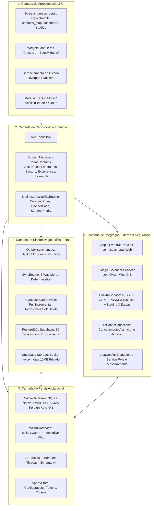
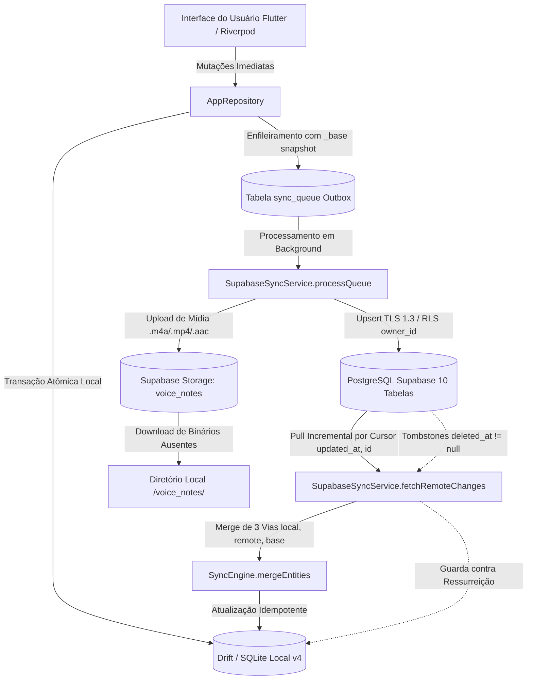

# Arquitetura do Sistema: Ministério Pessoal (Field Assistant)

## 1. Visão Geral do Sistema e Missão Offline-First

O **Field Assistant (Ministério Pessoal)** é um sistema multiplataforma projetado para gerenciamento do ministério pastoral e pessoal de campo. Sua premissa fundacional e inegociável é o **Offline-First Irrestrito**: toda e qualquer operação do usuário — criação de contatos, registros de conversas e visitas, condução e atualização de estudos bíblicos, gravação de notas de voz, marcação de compromissos na agenda e anotações territoriais — é gravada de forma **síncrona e imediata** no banco de dados local Drift (SQLite nativo no iOS, Android, macOS e Windows; Drift Wasm com IndexedDB no navegador Web).

A interface de usuário **nunca aguarda** resposta de rede para confirmar qualquer ação ministerial. A sincronização em nuvem e a integração com calendários externos operam como processos assíncronos desacoplados em segundo plano, garantindo usabilidade total sob condições adversas de campo, sem sinal de celular ou em trânsito.

---

## 2. Plataformas e Tecnologias

- **Framework de UI:** Flutter 3 / Dart SDK com suporte a compilação cruzada para:
  - **Web (WASM / CanvasKit):** Navegadores Desktop e Mobile via Drift Wasm e IndexedDB.
  - **iOS:** Dispositivos de referência iPhone XR, iPhone 13+ e iPad 11 A16.
  - **Desktop / Android:** Suporte nativo com SQLite C puro embutido.
- **Persistência Relacional Local:** Drift (antigo Moor) com tipagem estrita no Dart:
  - Mobile/Desktop: `NativeDatabase.createInBackground` com `PRAGMA foreign_keys = ON;`, `PRAGMA journal_mode = WAL;`, `PRAGMA synchronous = NORMAL;` e `busy_timeout = 5000;`.
  - Web: `WasmDatabase` executando `sqlite3.wasm` e worker canônico dedicado `web/drift_worker.js`.
- **Gerenciamento de Estado:** Flutter Riverpod (`StateNotifierProvider`, `StreamProvider`, `Provider`) proporcionando reatividade desacoplada, alta testabilidade sem UI e injeção de dependências substituível em testes.
- **Backend Remoto:** Supabase (PostgreSQL 15+, PostgREST, GoTrue Auth e Supabase Storage).
- **Segurança & RLS:** Políticas de Row-Level Security estritas isolando todos os registros por `owner_id = auth.uid()`.
- **Criptografia & Backup:** Envelope criptográfico v2 autenticado via AES-256-GCM com chave derivada por PBKDF2-HMAC-SHA256 (100.000 iterações e salt criptográfico de 16 bytes).
- **Hardware de Mídia:** Gravação de áudio nativa em formato `.m4a`/`.aac` com timer físico de parada compulsória em 30 segundos (`package:record`) e reconhecimento de voz offline com degradação graciosa (`package:speech_to_text`).

---

## 3. Topologia Real do Repositório (`lib/`)

A organização física do código-fonte em `lib/` reflete os domínios de negócio, serviços de infraestrutura e componentes de apresentação do projeto:

```
lib/
├── activities/            # Cronômetro ministerial e lógica autocorretiva de atividade (auto_corrective_timer_logic.dart)
├── appointments/          # Gestão de agenda, motor de disponibilidade, Plan B, provedores Apple EventKit e Google Calendar, importação/exportação ICS
├── contacts/              # Gestão de contatos telefônicos importados, briefing porta a porta e sementes recentes
├── core/                  # Configurações imutáveis (AppConfig), logging seguro, temas (Material 3 e Sun Mode), utilitários e boot desacoplado (SupabaseInitializer)
├── dashboard/             # Regras teocráticas de contagem ministerial, ritmo de pioneiro e motor de priorização de estudantes
├── database/              # Esquema Drift (22 tabelas tipadas), AppDatabase, migrações versionadas (v1 a v4), adaptadores nativo/web e AppRepository
├── experiences/           # Gestão de relatos e experiências memoráveis de campo
├── family/                # Gestão de laços familiares e vínculos de parentesco entre contatos
├── media/                 # Seletores de imagem, gestão de fotos de moradores e abstrações multiplataforma (stub/web/native)
├── publications/          # Catálogos de publicações (livro LFF, periódicos) e resolvedor de links JW Library (PublicationLinkResolver)
├── reports/               # Geração e exportação de relatórios ministeriais (S-4, resumos mensais) e downloads web
├── research/              # Artigos temáticos de pesquisa bíblica e tags de categorização
├── settings/              # Preferências do app, envelope de backup v2 (AES-256-GCM + PBKDF2) e restauração em 3 etapas (staging)
├── sync/                  # Motor offline-first: fila transacional outbox (sync_queue), 3-way merge determinístico e SupabaseSyncService
├── territory/             # Gestão de marcos territoriais, setores, geocodificação e cache de tiles cartográficos GIS com cancelamento de zoom
├── ui/                    # Apresentação: telas principais, widgets modulares reutilizáveis, navegação e providers Riverpod
└── voice_notes/           # Gravação física com parada em 30s, transcrição/ditado com fallback offline e parser inteligente de notas
```

---

## 4. Arquitetura em 5 Camadas

O sistema é estruturado em cinco camadas com fronteiras de responsabilidade bem delimitadas:



### Detalhamento das Camadas

1. **Camada de Apresentação & UI (`lib/ui/`):**
   - Implementada em Flutter com Material 3, suporte a Dynamic Type, alto contraste (`sunModeTheme`) para leitura sob luz solar direta e alvos de toque em conformidade estrita com acessibilidade ($\ge 48\times 48$ dp).
   - Telas complexas decompostas em sub-árvores modulares e widgets reutilizáveis em `lib/ui/widgets/`, preservando chaves de estado de testes (`ValueKey`).
   - Gerenciamento reativo via Riverpod, consumindo `StreamProvider` e `StateNotifierProvider` sem consultas diretas de banco de dados na árvore de widgets.

2. **Camada de Repositório & Domínio (`lib/database/repository.dart`, `lib/*/managers`):**
   - `AppRepository` centraliza todas as operações de dados do aplicativo.
   - Encapsula regras de negócio, garantia de transações atômicas agrupando mutações em tabelas primárias e enfileiramento correspondente na `sync_queue`.
   - Managers especializados (`PhoneContactsManager`, `VoiceNotesManager`, `LandmarkManager`, etc.) orquestram domínios específicos com capturas de snapshot `_base` e incremento monotônico de `revision`.
   - Motores de domínio puro (`AvailabilityEngine`, `CountingRules`, `PioneerPaceCalculator`, `StudentPriorityEngine`) operam sem acoplamento a frameworks de UI.

3. **Camada de Persistência Local (`lib/database/tables.dart`, `app_database.dart`):**
   - 22 tabelas fortemente tipadas no Drift (`schemaVersion: 4`).
   - SQLite nativo configurado com `PRAGMA foreign_keys = ON;` e `PRAGMA journal_mode = WAL;`.
   - Tabela `app_kv_store` para armazenamento durável de parâmetros, carimbos de sincronização, tokens criptográficos e snapshots de recuperação Web.

4. **Camada de Sincronização Offline-First (`lib/sync/`):**
   - Outbox transacional (`sync_queue`) processada em segundo plano com backoff exponencial e jitter aleatório.
   - Sincronização incremental com Supabase PostgREST (10 tabelas sincronizadas) orientada por cursor composto determinístico `(updated_at, id)`.
   - Upload e download de arquivos de áudio binários reais (`.m4a`, `.mp4`, `.aac`) para o bucket privado `voice_notes` no Supabase Storage.
   - Reconciliação concorrente de 3 vias (`SyncEngine.mergeEntities`) utilizando snapshots `local`, `remote` e `_base`.
   - Exclusões lógicas propagadas via tombstones (`deleted_at != null`) com bloqueio ativo contra ressurreição por nós desatualizados.

5. **Camada de Integração Externa & Segurança:**
   - Coordenação de calendários externos com Apple EventKit e Google Calendar via tabela intermediária `calendar_event_links`.
   - Isolamento de plataforma (`_isWebPlatform`) impedindo falhas de plugins nativos no navegador Web.
   - Sistema de exportação e restauração criptográfica de backup v2 (AES-256-GCM + PBKDF2) com staging transacional em 3 etapas contra perda de arquivos.
   - Validação de ambiente imutável via `AppConfig`, bloqueando credenciais administrativas e garantindo mascaramento de segredos em logs.

---

## 5. Ciclo de Vida da Sincronização e Fluxo da Outbox

O fluxo completo de sincronização offline-first e persistência remota é esquematizado a seguir:



---

## 6. Camada de Persistência Local: 22 Tabelas Drift

O banco de dados Drift define 22 tabelas tipadas no arquivo `lib/database/tables.dart`, organizadas nas seguintes categorias funcionais:

| # | Tabela Drift | Tabela SQL | Escopo / Finalidade | Sincroniza Supabase? |
|---|---|---|---|:---:|
| 1 | `People` | `people` | Contatos de moradores, interesses, idioma, restrições e notas | Sim (1) |
| 2 | `Visits` | `visits` | Registros cronológicos de conversas, revisitas e tentativas | Sim (2) |
| 3 | `BibleStudies` | `bible_studies` | Estudos bíblicos ativos, publicações em estudo e status | Sim (3) |
| 4 | `StudyParticipants` | `study_participants` | Mapeamento N:M de participantes vinculados a estudos | Sim (4) |
| 5 | `StudySessions` | `study_sessions` | Sessões de estudo realizadas, parágrafos e duração | Sim (5) |
| 6 | `Appointments` | `appointments` | Agenda pastoral, horários, status, conflitos e `is_provisional` | Sim (6) |
| 7 | `ActivityRecords` | `activity_records` | Relatórios de horas, minutos, modalidades de campo e metas | Sim (7) |
| 8 | `VoiceNotes` | `voice_notes` | Metadados e links de anotações de voz gravadas no campo | Sim (8) |
| 9 | `PhoneContacts` | `phone_contacts` | Contatos telefônicos importados da agenda do aparelho | Sim (9) |
| 10 | `TerritoryLandmarks` | `territory_landmarks` | Pontos de referência, comércios e marcos no mapa | Sim (10) |
| 11 | `SyncQueue` | `sync_queue` | Outbox persistente de operações pendentes para envio à nuvem | Não (Local) |
| 12 | `AppKvStore` | `app_kv_store` | Chave-valor durável de tokens, cursors, timestamps e flags | Não (Local) |
| 13 | `ExternalCalendarEvents` | `external_calendar_events` | Cache de eventos dos calendários nativos (Google/Apple) | Não (Local) |
| 14 | `CalendarEventLinks` | `calendar_event_links` | Mapeamento relacional entre compromissos locais e externos | Não (Local) |
| 15 | `TerritorySectors` | `territory_sectors` | Subdivisões territoriais internas | Não (Local) |
| 16 | `FamilyTies` | `family_ties` | Graus de parentesco e vínculos familiares entre contatos | Não (Local) |
| 17 | `PersonPhotos` | `person_photos` | Referências a fotos locais dos moradores | Não (Local) |
| 18 | `PersonPublications` | `person_publications` | Histórico normalizado de publicações entregues a contatos | Não (Local) |
| 19 | `MinistryExperiences` | `ministry_experiences` | Anotações detalhadas de relatos memoráveis de pregação | Não (Local) |
| 20 | `ResearchArticles` | `research_articles` | Artigos e notas de pesquisa bíblica para pregação | Não (Local) |
| 21 | `ResearchTags` | `research_tags` | Tags de classificação de artigos de pesquisa | Não (Local) |
| 22 | `StudentManualOrder` | `student_manual_order` | Ordem de classificação manual de estudantes na congregação | Não (Local) |

---

## 7. Protocolo de Sincronização em Nuvem (Supabase)

### 7.1 Isolamento por Row Level Security (RLS) via `owner_id`
Todas as 10 tabelas sincronizadas no PostgreSQL remoto contêm a coluna `owner_id UUID REFERENCES auth.users(id) DEFAULT auth.uid()`. As políticas de RLS garantem que um usuário jamais acesse, visualize ou modifique registros de outro publicador:
```sql
CREATE POLICY "owner_isolation_select" ON public.people
  FOR SELECT USING (auth.uid() = owner_id);

CREATE POLICY "owner_isolation_insert" ON public.people
  FOR INSERT WITH CHECK (auth.uid() = owner_id);

CREATE POLICY "owner_isolation_update" ON public.people
  FOR UPDATE USING (auth.uid() = owner_id) WITH CHECK (auth.uid() = owner_id);

CREATE POLICY "owner_isolation_delete" ON public.people
  FOR DELETE USING (auth.uid() = owner_id);
```

### 7.2 Sincronização de Áudios via Supabase Storage
- Bucket privado dedicado: `voice_notes` (`public = false`, limite de 10 MB por arquivo).
- MIME types aceitos: `audio/m4a`, `audio/x-m4a`, `audio/mp4`, `audio/aac`.
- Validação RLS no bucket `storage.objects`: a inserção de áudio só é aceita se o ID do arquivo coincidir com uma nota de voz pertencente ao usuário autenticado:
  ```sql
  CREATE POLICY "voice_notes_storage_insert" ON storage.objects
    FOR INSERT TO authenticated WITH CHECK (
      bucket_id = 'voice_notes' AND
      EXISTS (
        SELECT 1 FROM public.voice_notes vn
        WHERE vn.id::text = regexp_replace(storage.objects.name, '\.[^.]+$', '')
          AND vn.owner_id = auth.uid()
      )
    );
  ```
- No fluxo de sincronização, o upload de áudio ocorre antes da marcação da operação como sincronizada. Em caso de falha de upload de mídia, a operação permanece em estado `failed` com backoff para nova tentativa, prevenindo que metadados fiquem órfãos de seu arquivo de mídia.

### 7.3 Soft Delete via Tombstones e Barreira contra Ressurreição
- Exclusões físicas remotas (`DELETE FROM ...`) foram completamente abolidas.
- A outbox converte exclusões em envio de tombstones (`deleted_at != null`, `updated_at`, `revision`).
- Trigger PostgreSQL `handle_soft_delete_and_resurrection_guard()` impede que um `UPSERT` antigo com `deleted_at = NULL` anule um tombstone pré-existente.
- No cliente Dart, `_applyRemoteRecord` rejeita a ressurreição de registros excluídos localmente, a menos que o registro remoto comprove restauração legítima e mais recente (`remoteRev > localRev` e `remoteUpdated.isAfter(localDeletedAt)`).

### 7.4 Cursor Incremental Composto
O pull incremental de deltas remotos é indexado por ordenação e filtro composto:
```dart
activeClient
    .from(tableName)
    .select()
    .or('updated_at.gt.$lastSyncedAt,and(updated_at.eq.$lastSyncedAt,id.gt.$lastId)')
    .order('updated_at', ascending: true)
    .order('id', ascending: true)
    .limit(pageSize);
```
O cursor no `app_kv_store` só avança até o carimbo do último registro efetivamente aplicado com sucesso na base local, eliminando o risco de pular registros que compartilham o mesmo milissegundo.

### 7.5 Reconciliação de 3 Vias (3-Way Merge)
Conflitos concorrentes entre modificações offline em múltiplos dispositivos são resolvidos pelo `SyncEngine.mergeEntities`:
- O enfileiramento na outbox captura o estado prévio `_base: existing.toMap()`.
- Com as versões `local`, `remote` e `_base`, o algoritmo avalia mutações campo a campo com normalização profunda de coleções (listas e mapas JSONB).
- Modificações em campos distintos são mescladas automaticamente.
- Modificações conflitantes no mesmo campo preservam a integridade e sinalizam necessidade de decisão sem perda cega de dados.

---

## 8. Segurança, Governança de Ambiente e Backup Criptográfico

### 8.1 Validação Imutável de Ambiente (`AppConfig`)
A configuração da aplicação é centralizada na classe imutável `AppConfig` (`lib/core/app_config.dart`):
- Bloqueio ativo de chaves privilegiadas: qualquer chave com payload JWT contendo `service_role`, `supabase_admin`, `super_admin` ou prefixos `sbp_` é rejeitada na inicialização.
- Exigência estrita de HTTPS para o endpoint Supabase em ambiente de produção.
- Mascaramento compulsório de segredos em `toString()` e logs técnicos.
- Suporte total ao modo desconectado (`isOfflineOnly`), permitindo operação imediata sem credenciais remotas.

### 8.2 Envelope Criptográfico de Backup v2
O serviço de backup (`lib/settings/backup_service.dart`) gera arquivos seguros com especificação criptográfica v2:
- **Derivação de Chave:** PBKDF2-HMAC-SHA256 com 100.000 iterações e salt aleatório de 16 bytes gerado via `Random.secure()`.
- **Cifra Autenticada:** AES-256-GCM com tag de autenticação de 128 bits e IV de 16 bytes.
- **Restauração em 3 Etapas (Staging):**
  1. Extração para diretório isolado de staging (`safety_staging/<uuid>/`).
  2. Backup prévio de qualquer arquivo local pré-existente a ser substituído (`safety_audio_backup/<uuid>/`).
  3. Movimentação atômica para `/voice_notes/` apenas após confirmação (commit) da transação relacional SQLite.
  4. Em caso de falha, reversão instantânea dos arquivos substituídos a partir do backup e limpeza de resíduos.
- **Proibição de Diretórios Temporários:** Proibição explícita de uso de `Directory.systemTemp` ou `/tmp` para persistência de segurança, lançando `StorageUnavailableException` caso o sistema operacional não forneça armazenamento persistente seguro.

---

## 9. Integrações de Calendário Externo e Cartografia GIS

### 9.1 Sincronização de Calendários (Apple EventKit & Google Calendar)
- Mapeamento bidirecional orquestrado por `CalendarSyncCoordinator` através da tabela `calendar_event_links`.
- Proteção contra anomalias de exclusão em massa: interrupção de sincronização quando mais de 25% dos eventos desaparecem súbita e simultaneamente da API do sistema operacional sem evento explícito de cancelamento.
- Fingerprint SHA-256 de detecção de alterações incluindo regra de recorrência (`recurrenceRuleStr`).
- **Isolamento de Plataforma Web (`_isWebPlatform`):** O provedor Apple EventKit intercepta chamadas nativas quando em execução no navegador Web, impedindo erros `MissingPluginException`. Na Web, o Google Calendar utiliza o fluxo moderno Google Identity Services (GIS) Web OAuth desacoplado de canais de plataforma.

### 9.2 Otimização e Fluidez Cartográfica GIS
O mapa ministerial (`contacts_map_screen.dart`) opera com gerenciamento de blocos cartográficos através de `TileCacheCancellable`:
- **Cancelamento Assíncrono de Zoom:** Cancelamento imediato de requisições de download de blocos pertencentes a níveis de zoom que o usuário já ultrapassou (`cancelZoomExcept`), evitando filas de timeout.
- **Ordenação Focal pelo Viewport:** Carregamento ordenado a partir do centro visual do usuário (`focalTileX, focalTileY`), priorizando os blocos visíveis na tela.
- **Escrita Assíncrona Desacoplada:** Gravação em disco em segundo plano sem travar a thread de renderização da UI.
- **Cache Negativo:** Bloqueio temporário (20s) para requisições com falha repetida (429/404), prevenindo tempestades de rede.

---

## 10. Princípios Arquiteturais e Regras Inegociáveis

1. **Autoridade Imediata do SQLite Local:** Toda mutação é consolidada no Drift antes de qualquer transmissão de rede. O aplicativo nunca trava ou exibe spinners bloqueantes aguardando a nuvem.
2. **Regras Teocráticas Rígidas de Contagem Ministerial:**
   - `BibleStudy` $\neq$ `StudySession` $\neq$ `Participant` $\neq$ `Visit`.
   - Um estudo bíblico com múltiplos participantes é contabilizado como **exatamente 1 estudo**.
   - Sessões de estudo canceladas ou não realizadas **NÃO** contam como estudo realizado.
   - Tentativas de visita sem contato **NÃO** contam como revisitas realizadas.
3. **Imutabilidade e Rastreabilidade Histórica:**
   - Visitas e sessões de estudo são registros históricos pontuais e imutáveis.
   - Atualizações em agendamentos futuros não adulteram o histórico de visitas passadas.
4. **Resolução Explícita sem Sobrescrita Cega:** Proibição de estratégias simplistas de "Last Write Wins" que descartem notas de conversa sem conhecimento do usuário.
5. **Privacidade e Isolamento Rigoroso:**
   - Nenhum log ou telemetria trafega com anotações de moradores ou nomes de pessoas.
   - Isolamento de dados multiusuário estritamente garantido por `owner_id = auth.uid()` em todas as tabelas e buckets.
   - Proibição absoluta de segredos administrativos (`service_role`) no código cliente.
