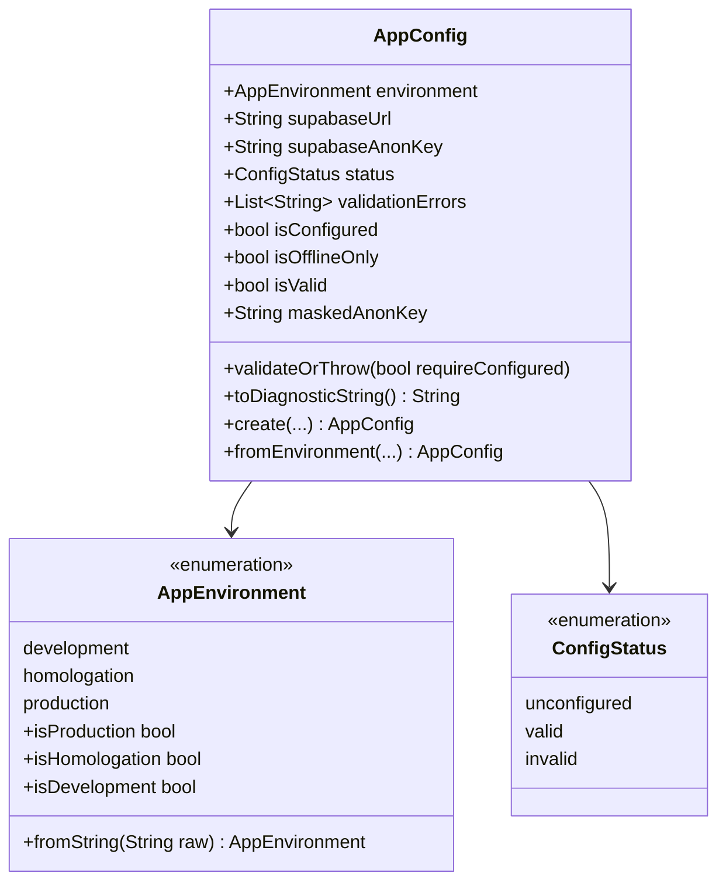

# GUIA DE CONFIGURAÇÃO E INJEÇÃO DE AMBIENTE (FIELD ASSISTANT)

Este documento estabelece o padrão oficial de injeção de parâmetros de ambiente, segredos e credenciais no **Field Assistant** (`ministerio_pessoal`), em conformidade com as diretrizes de segurança e a arquitetura **Offline-First**.

---

## 1. Princípios de Segurança e Integridade

1. **Sem dependência de leitura implícita em runtime:** O Dart/Flutter não lê arquivos `.env` do sistema de arquivos durante a execução compilada. A injeção ocorre exclusivamente em tempo de compilação via `--dart-define` ou `--dart-define-from-file`.
2. **Proibição categórica de chaves privilegiadas:** A `service_role` key do Supabase possui privilégios de superusuário que contornam o Row Level Security (RLS). O validador central (`AppConfig`) inspeciona tokens e rejeita sumariamente qualquer chave que possua a role `service_role` (mesmo com codificação base64url com `-` ou `_`), `supabase_admin`, `super_admin`, `admin`, `postgres` ou tokens de gerenciamento `sbp_`.
3. **Higienização e segurança de URLs:** O endpoint `SUPABASE_URL` rejeita credenciais de usuário embebidas (`userInfo` como `admin:pass@`), query parameters e fragmentos. Em logs, o helper `maskedUrl` mascara credenciais de autenticação automaticamente, e barras finais redundantes são normalizadas.
4. **Máscara estrita de dados sensíveis em logs:** `AppConfig.maskedAnonKey` e o método `toString()` exibem apenas os primeiros 6 e últimos 4 caracteres das chaves (`eyJhbG...cdef`), impedindo o vazamento de segredos em consoles ou relatórios de crash. Em caso de configuração inválida, `toDiagnosticString()` expõe os detalhes dos erros sem vazar dados confidenciais.
5. **Fallback offline limpo e transparente:** A ausência de variáveis de ambiente do Supabase não quebra a aplicação nem gera alertas de erro. O aplicativo entra deterministicamente no modo **Offline-Only**, preservando todas as mutações no banco local Drift SQLite e na fila outbox (`sync_queue`).
6. **Proteção estrita no `.gitignore`:** Todas as variantes de arquivos `.env` (`.env`, `.env.local`, `.env.homolog`, `.env.prod`) são ignoradas pelo Git, permitindo apenas o versionamento de templates `.example`.
7. **Distinção clara entre configuração ausente e falha de rede:**
   - **Configuração ausente:** `AppConfig.isOfflineOnly == true`. O cliente nem tenta conectar a serviços remotos; dados permanecem seguros no dispositivo.
   - **Falha de rede / indisponibilidade:** `AppConfig.isConfigured == true`, mas o backend está inacessível ou o dispositivo está temporariamente sem internet. O status reporta `waitingConnection` com retentativa via backoff exponencial.

---

## 2. Variáveis Suportadas

| Variável | Obrigatória | Valores Aceitos | Padrão | Descrição |
|---|---|---|---|---|
| `APP_ENV` | Não | `dev`, `homolog`, `prod` | `dev` | Define o ambiente de execução e as regras de segurança aplicáveis. |
| `SUPABASE_URL` | Sim (p/ sync) | URI válida com `http` ou `https` | `""` (vazio) | Endpoint do Supabase. Em `homolog`, exige `https` para hosts remotos. Em `prod`, exige estritamente `https` (inclusive localhost é rejeitado). |
| `SUPABASE_ANON_KEY` | Sim (p/ sync) | JWT válido com role `anon` (>= 20 chars, sem espaços/quebras) | `""` (vazio) | Chave pública anônima do projeto Supabase. |

---

## 3. Ambientes e Ciclo de Vida

### 3.1 Desenvolvimento (`APP_ENV=dev`)
- Permite conexões locais via HTTP (ex: `http://127.0.0.1:54321` ou `http://localhost:54321` em instâncias locais do Supabase CLI).
- Logs detalhados em modo debug.
- Arquivo de referência: `.env.example` -> copiar para `.env`.

### 3.2 Homologação / Staging (`APP_ENV=homolog`)
- Destinado a testes de integração contínua, homologação em TestFlight interno ou staging web.
- Exige obrigatoriamente protocolo HTTPS para endpoints remotos (permite localhost para QA local).
- Arquivo de referência: `.env.homolog.example` -> copiar para `.env.homolog`.

### 3.3 Produção (`APP_ENV=prod`)
- Ambiente final distribuído para os publicadores.
- Validação estrita: exige HTTPS irrestrito (inclusive em localhost), rejeita placeholders, userInfo, query parameters, e bloqueia chaves privilegiadas.
- Arquivo de referência: `.env.prod.example` -> copiar para `.env.prod`.

---

## 4. Comandos de Execução e Build

### 4.1 Execução no Flutter Web

#### Modo Automático Resiliente (detecta `.env` automaticamente):
```powershell
# Execução direta com fallback transparente e detecção automática de .env:
.\scripts\run_web.bat --server
# ou em PowerShell:
.\scripts\run_web.ps1 -Server
```

#### Especificando arquivo de ambiente explicitamente:
```powershell
.\scripts\run_web.ps1 -Server -EnvFile .env.homolog
```

#### Via Flutter CLI padrão:
```bash
flutter run -d chrome --dart-define-from-file=.env
```

### 4.2 Execução no Desktop / Dispositivo Móvel

```bash
# Modo desenvolvimento com .env:
flutter run --dart-define-from-file=.env

# Modo puramente offline (sem flags):
flutter run
```

### 4.3 Compilação de Release

#### Web Release (Produção):
```bash
flutter build web --release --dart-define-from-file=.env.prod
```

#### iOS Release (Archive / IPA):
```bash
flutter build ipa --release --dart-define-from-file=.env.prod
```

#### Testes de CI / Modo Offline:
```bash
# Executa testes sem variáveis remotas (validando modo offline):
flutter test
```

---

## 5. Arquitetura da Solução Centralizada (`AppConfig`)


