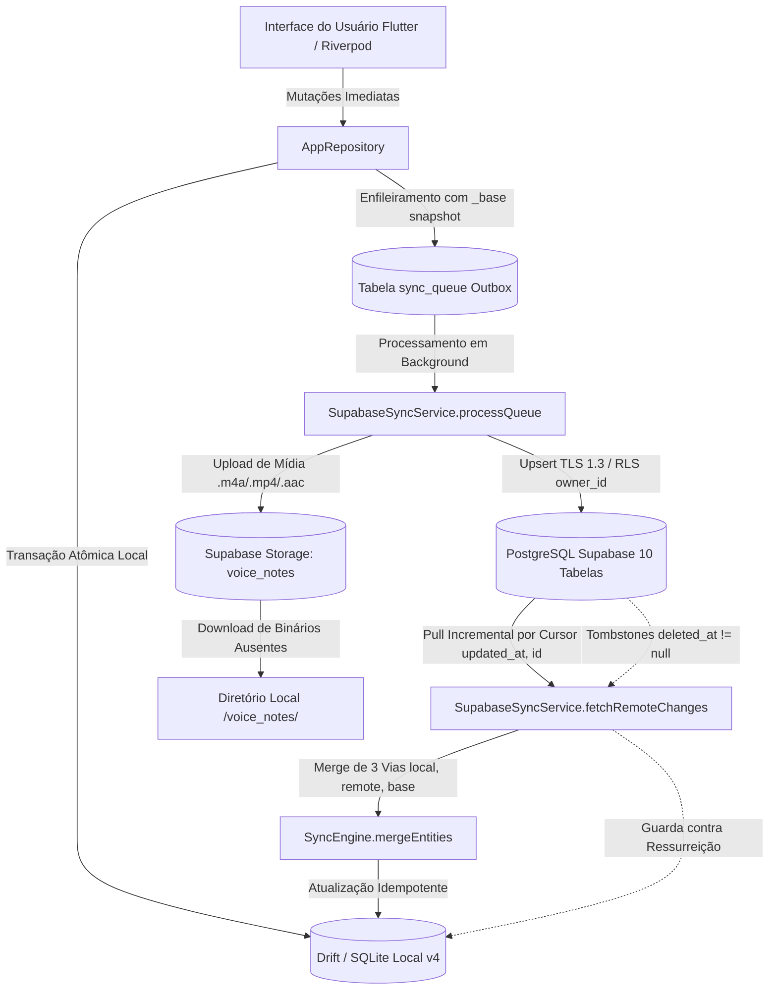
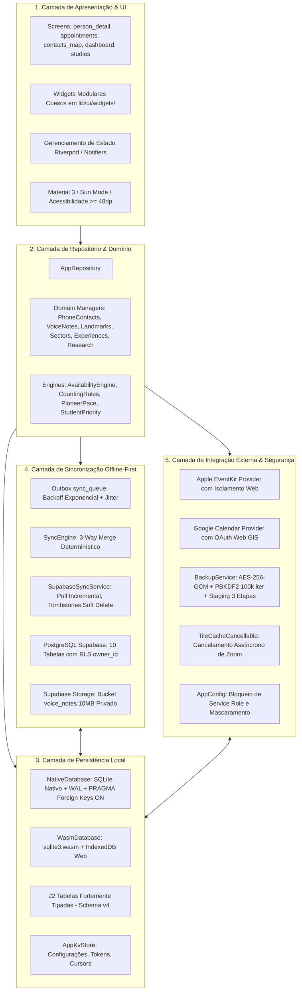

# Arquitetura de Engenharia: Ministério Pessoal (Field Assistant)

> **Documento Canônico Unificado:** A especificação arquitetural mestra do projeto está consolidada em [`docs/ARCHITECTURE.md`](../ARCHITECTURE.md). Este documento em `docs/engineering/` serve como referência técnica detalhada de engenharia para componentes de baixo nível, contratos de persistência e fluxos de sincronização.

---

## 1. Princípio Fundamental: Offline-First Irrestrito

Todas as ações do usuário — criação de contatos, registro de visitas, marcação de revisitas, alterações em estudos bíblicos, anotações de voz e compromissos — são escritas de forma **síncrona e imediata** no banco de dados local Drift (SQLite nativo no iOS, Android, macOS e Windows com `NativeDatabase` e Drift Wasm com IndexedDB na Web via `WasmDatabase`).

A interface de usuário **nunca aguarda** resposta de rede para confirmar qualquer ação ministerial.

---

## 2. Camadas de Dados e Isolamento em 5 Níveis

1. **Camada de Apresentação & UI (`lib/ui/`):**
   - Flutter Material 3, Riverpod, Dynamic Type e alto contraste (`sunModeTheme`).
   - Widgets modulares em `lib/ui/widgets/` mantendo chaves de estado de testes (`ValueKey`).

2. **Camada de Repositório & Domínio (`lib/database/repository.dart`, `lib/*/managers`):**
   - Abstração central `AppRepository` agrupando operações atômicas em `db.transaction`.
   - Domain managers com captura de snapshot `_base` e incremento monotônico de `revision`.
   - Motores de domínio desacoplados da interface (`AvailabilityEngine`, `CountingRules`, etc.).

3. **Camada de Persistência Local (`lib/database/tables.dart`, `app_database.dart`):**
   - 22 tabelas formais tipadas (`schemaVersion: 4`).
   - Configuração de conexão nativa com `PRAGMA foreign_keys = ON;` e `PRAGMA journal_mode = WAL;`.
   - Tabela `app_kv_store` para configurações, cursors de paginação e snapshots Web.

4. **Camada de Sincronização Offline-First (`lib/sync/`):**
   - **Outbox:** Processa a `sync_queue` ordenada cronologicamente com backoff exponencial e jitter.
   - **Pull Incremental:** Consulta paginada por cursor determinístico composto `(updated_at, id)`.
   - **Reconciliação 3-Way:** Algoritmo determinístico (`local`, `remote`, `_base`) evitando perda de edições concorrentes.
   - **Tombstones:** Soft delete propagado via `deleted_at != null` com guarda anti-ressurreição.
   - **Storage Binário:** Upload/download resiliente de notas de voz no bucket privado `voice_notes` (10 MB).

5. **Camada de Calendário Externo, Cartografia e Segurança:**
   - Coordenação bidirecional com Apple EventKit e Google Calendar via `calendar_event_links`.
   - Isolamento de plataforma Web (`_isWebPlatform`) e fluxo OAuth GIS Web.
   - Cache cartográfico `TileCacheCancellable` com cancelamento de zoom obsoleto e ordenação focal.
   - Envelope de backup v2 (AES-256-GCM + PBKDF2 100k iterações) e staging em 3 etapas.
   - Blindagem de ambiente via `AppConfig` com bloqueio de credenciais `service_role`.

---

## 3. Matriz de Tabelas e Sincronização

| Tabela Drift | Tabela SQL | Sincroniza Supabase? | RLS Remoto |
|---|---|:---:|:---:|
| `People` | `people` | Sim | `owner_id = auth.uid()` |
| `Visits` | `visits` | Sim | `owner_id = auth.uid()` |
| `BibleStudies` | `bible_studies` | Sim | `owner_id = auth.uid()` |
| `StudyParticipants` | `study_participants` | Sim | `owner_id = auth.uid()` |
| `StudySessions` | `study_sessions` | Sim | `owner_id = auth.uid()` |
| `Appointments` | `appointments` | Sim | `owner_id = auth.uid()` |
| `ActivityRecords` | `activity_records` | Sim | `owner_id = auth.uid()` |
| `VoiceNotes` | `voice_notes` | Sim | `owner_id = auth.uid()` |
| `PhoneContacts` | `phone_contacts` | Sim | `owner_id = auth.uid()` |
| `TerritoryLandmarks` | `territory_landmarks` | Sim | `owner_id = auth.uid()` |
| `SyncQueue` | `sync_queue` | Local | N/A |
| `AppKvStore` | `app_kv_store` | Local | N/A |
| `ExternalCalendarEvents` | `external_calendar_events` | Local | N/A |
| `CalendarEventLinks` | `calendar_event_links` | Local | N/A |
| `TerritorySectors` | `territory_sectors` | Local | N/A |
| `FamilyTies` | `family_ties` | Local | N/A |
| `PersonPhotos` | `person_photos` | Local | N/A |
| `PersonPublications` | `person_publications` | Local | N/A |
| `MinistryExperiences` | `ministry_experiences` | Local | N/A |
| `ResearchArticles` | `research_articles` | Local | N/A |
| `ResearchTags` | `research_tags` | Local | N/A |
| `StudentManualOrder` | `student_manual_order` | Local | N/A |
