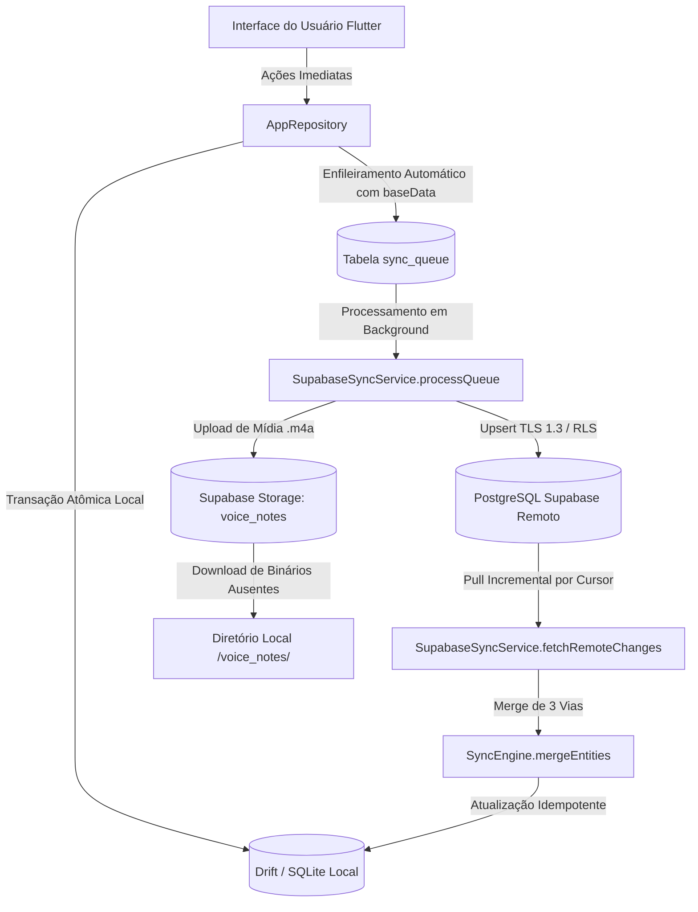

# ARQUITETURA REAL DO FIELD ASSISTANT

## 1. Princípio Fundamental: Offline-First Irrestrito

Todas as ações do usuário — criação de contatos, registro de visitas, marcação de revisitas, alterações em estudos bíblicos, anotações de voz e compromissos — são escritas de forma **síncrona e imediata** no banco de dados local Drift (SQLite nativo no iOS/macOS/Android/Windows e Drift Wasm com IndexedDB na Web).

A interface de usuário **nunca aguarda** resposta de rede para confirmar qualquer ação ministerial.

---

## 2. Camadas de Dados e Isolamento

1. **Camada de Persistência Local (`lib/database/tables.dart`, `app_database.dart`):**
   - 22 tabelas formais tipadas.
   - Schema version atual: `4`.
   - Chaves estrangeiras ligando compromissos, visitas, notas e participantes a pessoas e estudos.
   - Tabela `app_kv_store` para armazenamento durável de configurações, tokens, timestamps de sincronização e caminhos de snapshot.

2. **Camada de Repositório (`lib/database/repository.dart`):**
   - Abstração central para todas as mutações.
   - Garante que toda mutação local registre atomicamente sua intenção na tabela `sync_queue` com o payload de dados e `baseData` para viabilizar detecção de concorrência.

3. **Camada de Sincronização (`lib/sync/`):**
   - **Outbox:** Processa operações da `sync_queue` ordenadas por `created_at`.
   - **Inbound / Pull:** Consulta incremental paginada por cursor determinístico `(updated_at, id)`.
   - **Mesclagem:** Executa algoritmo de 3 vias (`local`, `remote`, `base`) prevenindo sobrescrita inadvertida de campos editados offline em múltiplos aparelhos.

4. **Camada de Calendário Externo (`lib/appointments/`):**
   - Coordena sincronização entre a tabela local `appointments` e os provedores Google Calendar e Apple EventKit.
   - Utiliza a tabela intermediária `calendar_event_links` para mapear IDs locais a IDs externos, guardando ETags e fingerprints SHA-256.

5. **Camada de Segurança e Backup (`lib/settings/backup_service.dart`):**
   - Exportação e importação de backup cifrado com AES-GCM (256 bits) e PBKDF2.
   - Staging de áudios e rollback transacional garantindo integridade de mídias originais.
