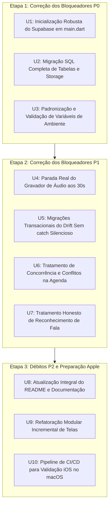

# RELATÓRIO DE AUDITORIA INICIAL — FIELD ASSISTANT
## Auditoria Técnica Integral, Revalidação de Falhas e Plano de Ação Priorizado

- **Data da Auditoria:** 01 de Novembro de 2026
- **Branch Base:** `master` (Commit `bd6f772`)
- **Ambiente:** Flutter 3.47.8 • Dart 3.13.7 • Windows / iOS Ready
- **Auditor Responsável:** Equipe Técnica Especializada de Engenharia de Software

---

## 1. Visão Geral da Arquitetura e Mapa de Módulos

O **Field Assistant** (`ministerio_pessoal`) é uma solução Flutter desenvolvida sob o paradigma **Offline-First**, estruturada para alta resiliência e integridade em ambientes sem conectividade de rede.

### 1.1 Diagrama de Camadas e Fluxo de Dados
```mermaid
flowchart TD
    subgraph UI_Layer [Camada de Apresentação (Flutter)]
        Screens[Screens: People, Detail, Studies, Appointments, Today, Activities]
        Widgets[Widgets Ergonômicos: Briefing, PaceCard, RecentSeeds, PlanB]
    end

    subgraph State_Layer [Camada de Estado (Riverpod)]
        Providers[Providers: dbProvider, repoProvider, syncProvider, settingsProvider]
    end

    subgraph Domain_Core [Regras de Negócio e Serviços Especializados]
        Avail[AvailabilityEngine & PlanBRecommender]
        Counting[CountingRules & PioneerPaceCalculator]
        Voice[AudioRecordingService & VoiceDictationService]
        Calendar[CalendarSyncCoordinator & AppleEventKitProvider]
        Backup[BackupService AES-GCM + PBKDF2]
    end

    subgraph Persistence_Layer [Persistência Local (Drift)]
        Repo[AppRepository]
        DriftDB[(AppDatabase v4 SQLite / Wasm)]
        SyncQueue[(Tabela sync_queue Outbox)]
    end

    subgraph Remote_Layer [Sincronização Remota (Supabase)]
        SyncEngine[SyncEngine: 3-Way Merge]
        SyncService[SupabaseSyncService: Cursor Determinístico]
        RemoteDB[(PostgreSQL Supabase com RLS)]
        Storage[(Supabase Storage: voice_notes)]
    end

    UI_Layer --> State_Layer
    State_Layer --> Domain_Core
    Domain_Core --> Persistence_Layer
    Repo --> DriftDB
    Repo --> SyncQueue
    SyncQueue --> SyncService
    SyncService --> SyncEngine
    SyncService --> RemoteDB
    SyncService --> Storage
```

### 1.2 Inventário de Módulos
1. `lib/database/`: Definições tipadas do Drift (`tables.dart`, 22 tabelas), camada de acesso a dados (`repository.dart`), conexões de plataforma (`connection/native.dart` e `connection_web.dart`).
2. `lib/sync/`: Sincronizador de fila (`supabase_sync_service.dart`), motor de mesclagem em 3 vias com detecção de conflitos (`sync_engine.dart`).
3. `lib/appointments/`: Motor de colisão de agenda estilo consultório (`availability_engine.dart`), coordenador de sincronização (`calendar_sync_coordinator.dart`), provedor nativo Apple EventKit (`apple_eventkit_provider.dart`), recomendador geográfico Haversine (`plan_b_recommender.dart`).
4. `lib/settings/`: Motor criptográfico de backup e restauração (`backup_service.dart`), gerenciador de preferências em chave-valor (`app_settings_manager.dart`).
5. `lib/voice_notes/`: Gravação via `package:record` (`audio_recording_service.dart`), ditado e transcrição via `speech_to_text` (`voice_dictation_service.dart`), parser theocrático de notas (`voice_note_parser.dart`).
6. `lib/dashboard/`: Regras formais de contagem theocrática (`counting_rules.dart`), calculadora de ritmo ministerial (`pioneer_pace_calculator.dart`), priorização de estudantes (`student_priority_engine.dart`).
7. `lib/contacts/`: Helper de consolidação de briefing na porta (`doorstep_briefing_helper.dart`), detector de sementes recentes (`recent_seeds_helper.dart`).
8. `lib/ui/`: Telas e widgets responsivos (18 telas e componentes adaptativos para iPhone e iPad).

---

## 2. Auditoria Cruzada: Documentação vs. Código vs. Testes vs. CI

| Componente | Afirmação na Documentação | Implementação Efetiva no Código | Validação em Testes Automatizados | Execução no CI (`ci.yml`) | Veredito da Auditoria |
|---|---|---|---|---|---|
| **Contagem de Testes** | `README.md` declara 32 testes na linha 68 e 412 na linha 121 | Suíte completa com 508 testes em `test/` | 508 testes executados com 100% de sucesso (`flutter test`) | `flutter test --coverage` executa os 508 testes | **Inconsistência Documental (P2)** — Documentação desatualizada |
| **Inicialização Supabase** | `SYNC_PROTOCOL.md` assume cliente Supabase pronto | `lib/main.dart` NÃO chama `Supabase.initialize()` | Testes usam `clientOverride` (mock), mascarando a falta em runtime | CI roda apenas testes e análise estática | **Falha Crítica Confirmada (P0)** — Runtime quebra ao configurar env |
| **Tabelas Remotas** | `SYNC_PROTOCOL.md` lista 10 tabelas sincronizáveis | `supabase_sync_service.dart` sincroniza 10 tabelas; `initial_schema.sql` só cria 7 tabelas | Testes simulam respostas mockadas para todas as tabelas | CI não roda migrações contra banco Postgres real | **Falha Crítica Confirmada (P0)** — 3 tabelas e storage omitidos |
| **Variáveis de Ambiente** | `.env.example` orienta `cp .env.example .env` | Código usa `String.fromEnvironment()`, que ignora arquivo `.env` | Nenhum teste valida injeção em release | CI não valida leitura de `.env` | **Falha Crítica Confirmada (P0)** — Variáveis não carregadas |
| **Limite de Gravação** | Notas rápidas de 30s | `audio_recording_service.dart` cancela o timer aos 30s mas não para o gravador | Teste de timeout não verifica se hardware parou | CI não testa hardware real | **Falha Grave Confirmada (P1)** — Gravação contínua em background |
| **Migrações SQLite** | Migrações incrementais seguras v1 -> v4 | `app_database.dart` usa `catch (_) {}` em 3 helpers | Nenhum teste força erro de sintaxe SQL na migração | CI não valida falha controlada | **Falha Grave Confirmada (P1)** — Erros de migração silenciados |
| **Concorrência Agenda** | Agenda sem conflitos estilo consultório | `AvailabilityEngine` só checa localmente; dois nós offline geram sobreposição | Testes cobrem apenas concorrência de único nó ou mesmo ID | CI não testa concorrência multi-dispositivo offline | **Falha Grave Confirmada (P1)** — Colisões silenciosas pós-sync |
| **Transcrição Offline** | Declarada como "offline-first" em comentários | Usa `speech_to_text` que depende de modelos de SO (rede na Web/iOS sem modelo) | Testes usam `FakeVoiceDictationService` | CI não testa engine nativo de voz | **Risco P1 Confirmado** — Usuário sem aviso de necessidade de rede |
| **Build iOS** | Suporte iPhone e iPad para produção | `Info.plist` pronto com permissões; `Podfile` ausente no repositório | Testes de widget testam layouts mobile e iPad | CI executa `flutter build ios --no-codesign --simulator` | **Pendente de Validação de Produção (P2)** — Archive real requer macOS |

---

## 3. Revalidação Detalhada dos Problemas Identificados

### 3.1 P0 — Inicialização do Supabase
- **Localização:** `lib/main.dart:9-12`
  ```dart
  void main() {
    WidgetsFlutterBinding.ensureInitialized();
    runApp(const ProviderScope(child: MinisterioPessoalApp()));
  }
  ```
- **Evidência:** Não há chamada a `Supabase.initialize()` em `main.dart` nem em qualquer outro arquivo do projeto.
- **Mecanismo de Falha:** Em `lib/sync/supabase_sync_service.dart:647, 826, 976`, o serviço tenta obter `clientOverride ?? Supabase.instance.client`. Quando `SUPABASE_URL` é fornecida, `isConfigured` torna-se `true`, mas ao tentar acessar `Supabase.instance.client`, uma exceção não tratada do SDK Supabase é lançada (`AssertionError: Supabase must be initialized before accessing Supabase.instance`).
- **Por que os testes passaram:** Os testes unitários injetam `clientOverride: mockClient`, ignorando o `Supabase.instance`.
- **Status:** **CONFIRMADO COMO BLOQUEADOR P0**.

### 3.2 P0 — Descompasso de Tabelas Remotas e Storage
- **Localização:** `supabase/migrations/20261026000000_initial_schema.sql` vs `lib/sync/supabase_sync_service.dart:52-63`
- **Evidência:**
  - O serviço local sincroniza 10 entidades:
    1. `people`, 2. `visits`, 3. `bible_studies`, 4. `study_participants`, 5. `study_sessions`, 6. `appointments`, 7. `activity_records`, 8. `voice_notes`, 9. `phone_contacts`, 10. `territory_landmarks`.
  - Além disso, `_uploadVoiceNoteAudio()` e `_downloadVoiceNoteAudio()` operam sobre o bucket de storage `'voice_notes'`.
  - No arquivo `20261026000000_initial_schema.sql`, as tabelas `voice_notes`, `phone_contacts` e `territory_landmarks` **NÃO EXISTEM**. O bucket de storage `voice_notes` também não é criado, nem suas políticas de RLS no Storage.
- **Mecanismo de Falha:** Em ambiente real, qualquer sincronização de notas de voz, contatos telefônicos ou marcos de território resulta em erro HTTP 404 / PostgREST `42P01` e falha de upload de mídia no Storage.
- **Status:** **CONFIRMADO COMO BLOQUEADOR P0**.

### 3.3 P0 — Injeção Incorreta de Configurações de Ambiente
- **Localização:** `lib/sync/supabase_sync_service.dart:68-75` e `.env.example`
  ```dart
  this.supabaseUrl = const String.fromEnvironment('SUPABASE_URL', defaultValue: ''),
  this.supabaseAnonKey = const String.fromEnvironment('SUPABASE_ANON_KEY', defaultValue: ''),
  ```
- **Evidência:** `String.fromEnvironment()` em Dart lê exclusivamente valores compilados passados via `--dart-define` ou `--dart-define-from-file`. Criar o arquivo `.env` na raiz conforme orientado em `.env.example` não tem efeito algum durante `flutter run` ou `flutter build`.
- **Mecanismo de Falha:** O app compila assumindo strings vazias, desativando a sincronização silenciosamente sem erro perceptível.
- **Status:** **CONFIRMADO COMO BLOQUEADOR P0**.

### 3.4 P1 — Limite de Gravação de Áudio Não Interrompe Hardware
- **Localização:** `lib/voice_notes/audio_recording_service.dart:120-132`
  ```dart
  _timer = Timer.periodic(const Duration(seconds: 1), (timer) {
    if (!_isRecording) {
      timer.cancel();
      return;
    }
    _elapsedSeconds++;
    if (!_durationController.isClosed) {
      _durationController.add(_elapsedSeconds);
    }
    if (_elapsedSeconds >= 30) {
      timer.cancel(); // <--- APENAS CANCELA O TIMER, NÃO CHAMA stopRecording()!
    }
  });
  ```
- **Evidência:** Ao atingir 30 segundos, o timer para de emitir eventos, mas o método `_audioRecorder.stop()` jamais é chamado. A variável `_isRecording` permanece `true`, o microfone do aparelho continua capturando e o arquivo continua inflando em disco.
- **Status:** **CONFIRMADO COMO BLOQUEADOR P1**.

### 3.5 P1 — Migrações do SQLite com Erros Silenciados
- **Localização:** `lib/database/app_database.dart:126, 175, 201`
  ```dart
  Future<void> _migrateLandmarksColumns() async {
    try { ... } catch (_) {}
  }
  Future<void> _migrateCustomTablesColumns() async {
    for (final tbl in tables) {
      try { ... } catch (_) {}
    }
  }
  Future<void> _migrateLegacyKvStore() async {
    try { ... } catch (_) {}
  }
  ```
- **Evidência:** Falhas em comandos DDL cruciais (como adição de colunas `updated_at`, `deleted_at`, `revision`) ou na migração do KV store são descartadas sem rastreabilidade ou log.
- **Status:** **CONFIRMADO COMO BLOQUEADOR P1**.

### 3.6 P1 — Concorrência na Agenda Entre Múltiplos Dispositivos Offline
- **Localização:** `lib/appointments/availability_engine.dart` e `lib/sync/sync_engine.dart`
- **Evidência:** O algoritmo de merge de 3 vias opera comparando registros com a mesma chave primária UUID. Se o usuário agendar a "Revisita de João" na quarta-feira às 14:00 no iPhone (UUID 1) e o mesmo horário para a "Revisita de Maria" no iPad (UUID 2) enquanto ambos estiverem sem internet, ao conectar ambos sincronizam os dois registros como inserções válidas. A tabela local `appointments` passará a conter dois compromissos sobrepostos no mesmo horário sem nenhum alerta visual na interface.
- **Status:** **CONFIRMADO COMO BLOQUEADOR P1**.

### 3.7 P1 — Transcrição Offline Declarada Sem Validação no Dispositivo
- **Localização:** `lib/voice_notes/voice_dictation_service.dart:18` e `ios/Runner/Info.plist:32`
- **Evidência:** A documentação e os comentários do código afirmam categoricamente que o ditado é "offline-first". No iOS, a biblioteca `speech_to_text` depende do modelo de reconhecimento no dispositivo baixado pelo usuário nos Ajustes do iOS. Se o modelo pt-BR não estiver baixado ou o dispositivo for anterior ao A12 Bionic, o reconhecimento requer internet e falha imediatamente no campo offline.
- **Status:** **CONFIRMADO COMO RISCO P1**.

### 3.8 P2 — Telas Monolíticas
- **Evidência:**
  - `person_detail_screen.dart`: 7.346 linhas
  - `appointments_screen.dart`: 4.379 linhas
  - `dashboard_screen.dart`: 2.927 linhas
  - `studies_screen.dart`: 2.713 linhas
  - `contacts_map_screen.dart`: 2.362 linhas
  - `people_screen.dart`: 2.054 linhas
- **Status:** **CONFIRMADO COMO DÉBITO ARQUITETURAL P2**.

### 3.9 P2 — Documentação Numérica Inconsistente
- **Evidência:** `README.md` menciona 32 e 412 testes; o total real auditado e aprovado é de 508 testes.
- **Status:** **CONFIRMADO COMO P2**.

---

## 4. Plano de Correção Priorizado por Etapas

As correções devem ser implementadas em unidades atômicas, isoladas, com testes automatizados acompanhando cada etapa.



### Detalhamento das Unidades de Correção

#### [P0] Unidade 1: Inicialização Tolerante a Falhas do Supabase em `main.dart`
- **Arquivos:** `lib/main.dart`, `lib/sync/supabase_sync_service.dart`
- **Solução:**
  1. Criar helper de inicialização assíncrono `initializeSupabaseIfConfigured()`.
  2. Executar `await Supabase.initialize(...)` em `main()` antes de `runApp()` apenas quando a URL e a Anon Key forem válidas.
  3. Proteger com `try/catch` tratando exceções de rede e inicializando em modo puramente offline caso falhe.
  4. Injetar o cliente inicializado no `supabaseSyncServiceProvider`.
- **Critério de Aceitação:** App abre normalmente tanto com credenciais válidas, credenciais inválidas ou sem credenciais, sem lançar `AssertionError`.

#### [P0] Unidade 2: Migração Supabase para Tabelas Ausentes e Storage
- **Arquivos:** `supabase/migrations/20261102000000_complete_sync_tables_and_storage.sql`
- **Solução:**
  1. Criar tabelas remotas `voice_notes`, `phone_contacts` e `territory_landmarks` com foreign keys, timestamps UTC e índices.
  2. Habilitar RLS em todas as novas tabelas com políticas `auth.uid() = owner_id`.
  3. Criar bucket de storage `'voice_notes'` privado com políticas de upload/download restritas ao usuário autenticado dono do arquivo (`(storage.foldername(name))[1] = auth.uid()::text`).
- **Critério de Aceitação:** Migração SQL executável no Supabase sem erros, garantindo compatibilidade 1:1 com `syncTables`.

#### [P0] Unidade 3: Configuração Padronizada de Ambiente
- **Arquivos:** `lib/core/app_config.dart`, `lib/sync/supabase_sync_service.dart`, `.env.example`, `README.md`
- **Solução:**
  1. Centralizar a leitura de configurações em classe tipada `AppConfig`.
  2. Documentar suporte formal a `--dart-define-from-file=.env` nos scripts e no README.
  3. Exibir no card de sincronização da UI indicação clara de "Supabase não configurado" ou "Conectado".
- **Critério de Aceitação:** Configuração injetável via `--dart-define` ou `--dart-define-from-file` de forma padronizada.

#### [P1] Unidade 4: Desligamento Efetivo do Hardware de Áudio aos 30 Segundos
- **Arquivos:** `lib/voice_notes/audio_recording_service.dart`, `test/voice_notes_test.dart`
- **Solução:**
  1. Quando `_elapsedSeconds >= 30`, chamar explicitamente `await stopRecording()`.
  2. Garantir que `_isRecording` seja setado para `false` e `_audioRecorder.stop()` seja executado.
  3. Criar teste unitário adversarial comprovando que atingir 30 segundos finaliza a gravação e retorna o arquivo fechado.
- **Critério de Aceitação:** A gravação é finalizada de fato aos 30 segundos, liberando o recurso de microfone.

#### [P1] Unidade 5: Eliminação de `catch (_) {}` nas Migrações do Drift
- **Arquivos:** `lib/database/app_database.dart`, `test/database_integrity_test.dart`
- **Solução:**
  1. Remover blocos `catch (_) {}` de `_migrateLandmarksColumns`, `_migrateCustomTablesColumns` e `_migrateLegacyKvStore`.
  2. Implementar verificações de schema idempotentes (verificando colunas antes de executar `ALTER TABLE`).
  3. Em caso de falha real, registrar erro detalhado e propagar a exceção para que a transação de migração seja revertida.
  4. Adicionar testes cobrindo upgrades simulados.
- **Critério de Aceitação:** Migrações seguras, verificáveis e sem supressão cega de exceções.

#### [P1] Unidade 6: Concorrência e Detecção de Colisões de Horários na Agenda
- **Arquivos:** `lib/appointments/availability_engine.dart`, `lib/ui/screens/appointments_screen.dart`, `test/availability_engine_test.dart`
- **Solução:**
  1. Expandir `AvailabilityEngine` para incluir método `findOverlappingAppointments(List<AppointmentEntry> list)`.
  2. Na tela de compromissos, marcar visualmente com badge de aviso (ex: "Conflito de Horário detectado após sincronização") qualquer par de compromissos ativos que sobreponham o mesmo horário.
  3. Oferecer ação rápida para reagendar um dos compromissos conflitantes.
- **Critério de Aceitação:** Compromissos concorrentes gerados por sincronização são destacados na interface para resolução pelo usuário.

#### [P1] Unidade 7: Comunicação Clara da Transcrição de Fala
- **Arquivos:** `lib/voice_notes/voice_dictation_service.dart`, `lib/ui/widgets/quick_voice_note_dialog.dart`, `ios/Runner/Info.plist`
- **Solução:**
  1. Ajustar o texto da descrição de uso em `Info.plist` e na interface: esclarecer que o ditado utiliza o mecanismo do sistema operacional e pode exigir download prévio do pacote de voz nos Ajustes do iOS ou conexão ativa.
  2. Tratar falhas de reconhecimento com mensagem amigável sugerindo digitação manual.
- **Critério de Aceitação:** Transparência com o usuário e ausência de falsas promessas de funcionamento offline garantido.

#### [P2] Unidade 8: Atualização do `README.md` e Métricas do Projeto
- **Arquivos:** `README.md`
- **Solução:**
  1. Atualizar contagem de testes para os 508 testes reais.
  2. Alinhar versão do Dart (3.13+) e Flutter (3.27+).
  3. Documentar comandos de build com `--dart-define-from-file=.env`.
- **Critério de Aceitação:** README 100% fidedigno ao estado real da base de código.

---

## 5. Conclusão da Auditoria da Fase 1

A base de código do **Field Assistant** possui uma fundação arquitetural sólida:
- Banco local Drift com 22 tabelas estruturadas, Foreign Keys e modo WAL.
- Suíte robusta de 508 testes automatizados aprovados e zero erros no analisador estático.
- Camada de backup criptografado AES-256 GCM com staging seguro de mídias.
- Proteções contra anomalias no Apple EventKit.

Entretanto, **a aplicação não está pronta para produção** devido a bloqueadores objetivos na camada de sincronização Supabase (inicialização ausente, tabelas e storage omitidos nas migrações SQL) e riscos de gravação de áudio e migrações locais.

**Recomendação Técnica:** Interromper a FASE 1 e aguardar a autorização do usuário para iniciar as correções da FASE 2 seguindo estritamente o plano priorizado acima.
