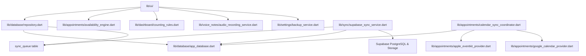

# MASTER CONTEXT — FIELD ASSISTANT (MINISTÉRIO PESSOAL)

## 1. Visão Geral do Produto
O **Field Assistant** (identificado internamente como `ministerio_pessoal`) é uma aplicação multiplataforma especializada na organização ministerial e pastoral pessoal de pioneiros e publicadores das Testemunhas de Jeová.

O foco primordial é o ecossistema Apple (**iPhone XR / iOS 15+** e **iPad 11 A16 / iPadOS 15+**), com suporte web responsivo e desktop local.

### Proposta de Valor e Princípios Fundamentais
1. **Offline-First Irrestrito:** A fonte primária de verdade é o banco de dados local SQLite (via Drift). Nenhuma ação de registro, leitura ou navegação depende de conectividade à internet ou do backend Supabase.
2. **Privacidade e Proteção de Dados por Design:** Telemetria zero, ausência de rastreadores analíticos, credenciais sensíveis nunca expostas, isolamento estrito de dados por usuário (`auth.uid() = owner_id`) via RLS no Supabase e criptografia forte em repouso nos backups (AES-256 GCM com PBKDF2).
3. **Contagem Ministerial Honesta e Determinística:** Rigor matemático e theocrático em regras de contagem (`BibleStudy` ≠ `StudySession` ≠ `Participant` ≠ `Visit`). Estudos com múltiplos participantes contam como exatamente 1 estudo ativo. Sessões canceladas ou não realizadas jamais contam como sessões realizadas.
4. **Agenda Estilo Consultório Médico:** O agendamento ministerial opera com validação de colisão em tempo real (`AvailabilityEngine`), bloqueando sobreposições acidentais e sugerindo horários vagos imediatos.
5. **Ergonomia e Alto Contraste para Uso Sob Luz Solar:** Suporte nativo a alvos de toque >= 48x48 dp, Dynamic Type para redimensionamento de fontes sem RenderFlex overflow e modo de alto contraste (`sunModeTheme`) para leitura direta sob sol forte em trabalho de campo.

---

## 2. Decisões Arquiteturais Centrais
- **Linguagem & Framework:** Dart 3.13.7 / Flutter 3.47.8.
- **Gerenciamento de Estado:** Flutter Riverpod (`flutter_riverpod: ^3.4.3`) com `ProviderScope`, providers imutáveis e streams reativos desacoplados da camada de UI.
- **Banco de Dados Local (Drift SQLite):**
  - Schema Version atual: `4`.
  - Conexão nativa (`lib/database/connection/native.dart`) com `PRAGMA foreign_keys = ON;`, `PRAGMA journal_mode = WAL;`, `PRAGMA synchronous = NORMAL;` e `busy_timeout = 5000;`.
  - Conexão Web (`lib/database/connection/connection_web.dart`) com SQLite compilado para WebAssembly (`drift/wasm.dart`) e armazenamento durável em IndexedDB.
- **Sincronização Remota (Supabase):**
  - Protocolo de Fila Transacional (`sync_queue`): Toda mutação no repositório gera atomicamente a operação local na fila com `baseData` para detecção de concorrência.
  - Pull Incremental com Cursor Determinístico: Paginação ordenada estritamente por `.order('updated_at', ascending: true).order('id', ascending: true)`.
  - Mesclagem de 3 Vias (`SyncEngine.mergeEntities`): Resolução a nível de campo, prevenindo que alterações concorrentes offline sobrescrevam anotações de visitas ou contatos.
- **Integração com Calendários Externos (`lib/appointments/`):**
  - Sincronização bidirecional com Apple EventKit (`device_calendar`) e Google Calendar (`googleapis`).
  - Mapeamento intermediário via `calendar_event_links`, prevenindo que exclusões externas apaguem o histórico pastoral interno.
  - Blindagem contra anomalias parciais de EventKit (>25% sumiço sem exclusão confirmada).
- **Mídia e Áudio (`lib/voice_notes/`):**
  - Gravação rápida via `record: ^7.1.2` com limite de 30 segundos e persistência em pasta isolada de documentos.
  - Transcrição via `speech_to_text: ^7.5.0` (sujeita a modelos no dispositivo ou internet).
- **Deep Linking JW Library (`lib/publications/publication_link_resolver.dart`):**
  - Resolução de URLs canônicas (`https://www.jw.org/finder?srcid=jwlshare...`) interceptadas nativamente pelo aplicativo oficial JW Library.

---

## 3. Dependências Entre Módulos

---

## 4. Estado Geral de Produção
- **Testes Automatizados:** 569 testes passando com 100% de sucesso (`flutter test`).
- **Análise Estática:** 0 issues com `--fatal-infos` (`dart analyze lib test --fatal-infos`).
- **Formatação:** 100% em conformidade (`dart format --output=none --set-exit-if-changed lib test`).
- **Compilação Web:** Sucesso (`flutter build web --release`).
- **Status Geral de Prontidão para Produção:** **REPROVADO** até a resolução dos bloqueadores P0 e P1 identificados e validação em hardware Apple real (ver `PRODUCTION_READINESS.md`).
